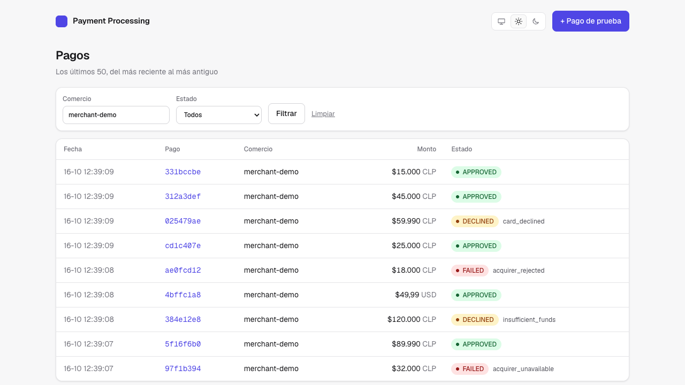
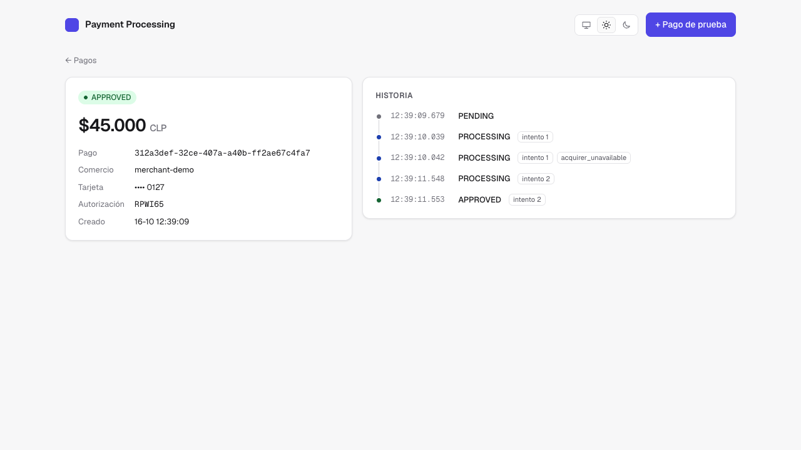
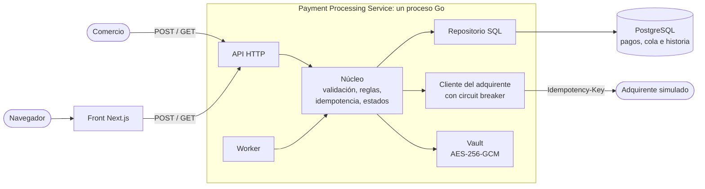
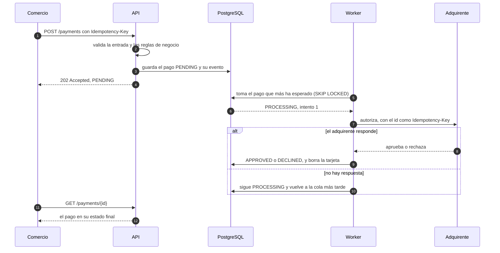
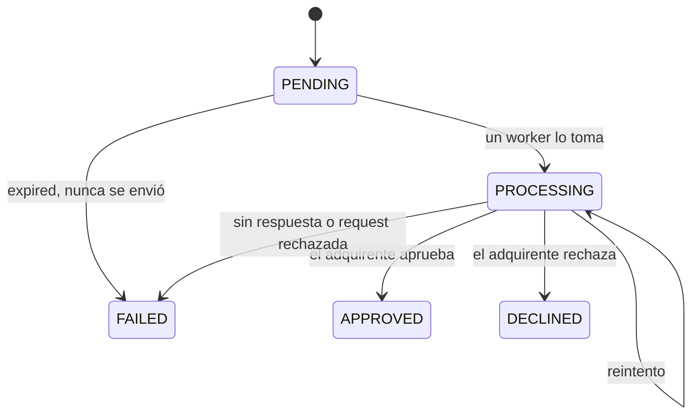
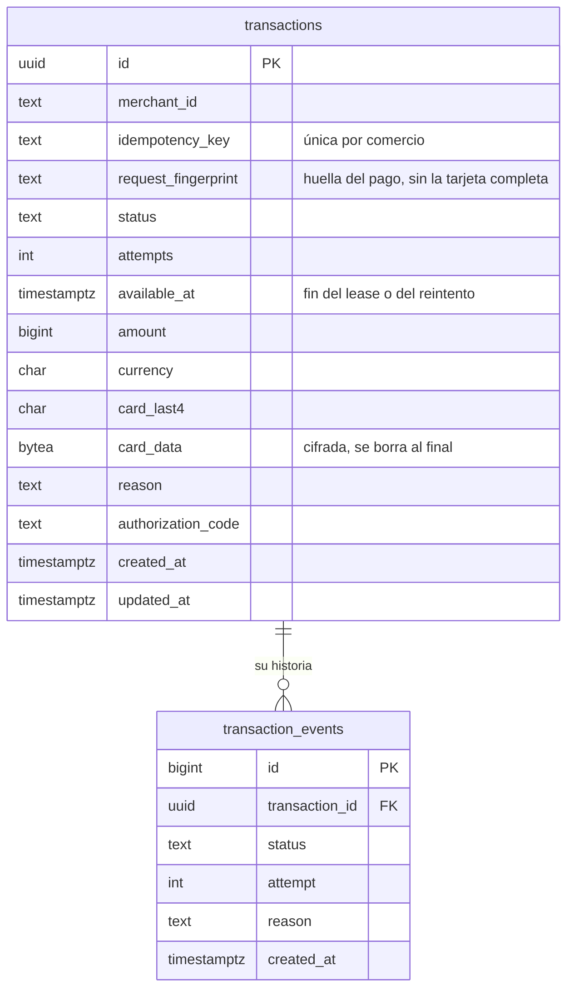

# Payment Processing Service

Servicio que recibe solicitudes de pago de comercios, las autoriza con un adquirente y deja la trazabilidad de cada transacción.

En el modelo de cuatro partes de los pagos con tarjeta (comercio, adquirente, red y emisor), este servicio está entre el comercio y el adquirente: recibe el pago, lo valida, lo autoriza con el adquirente y guarda su resultado. El adquirente es un servicio simulado que decide según el número de tarjeta.

**En resumen**

- El POST responde `202` en milisegundos y un worker autoriza el pago en segundo plano, con Postgres como cola (`SKIP LOCKED`).
- Una clave de idempotencia por comercio: un reintento nunca cobra dos veces.
- Cada cambio de estado deja un evento, escrito en la misma sentencia SQL que el cambio.
- Reintentos con backoff y jitter, circuit breaker y vencimiento de los pagos que nunca se enviaron.
- Un front en Next.js para ver cada pago y su historia, y crear pagos de prueba.

## Cómo correrlo

Requisito: Docker.

```bash
docker compose up --build
curl -i localhost:8080/health   # 200 {"status":"ok"}
```

La API queda en `localhost:8080` y el [front](#front) en [localhost:3000](http://localhost:3000).

Crear un pago (responde `202` con la transacción en `PENDING` y el header `Location`):

```bash
curl -i -X POST localhost:8080/payments \
  -H 'Content-Type: application/json' \
  -H 'Idempotency-Key: order-1001' \
  -d '{"merchant_id":"merchant-001","amount":15000,"currency":"CLP",
       "card":{"number":"4111111111111111","expiry_month":12,"expiry_year":2030,"cvv":"123"}}'
```

Un worker autoriza el pago en segundo plano, normalmente en menos de un segundo. Para ver el resultado:

```bash
curl -s localhost:8080/payments/<transaction_id>          # el pago, en su estado actual
curl -s localhost:8080/payments/<transaction_id>/events   # su historia, cambio por cambio
curl -s 'localhost:8080/payments?merchant_id=merchant-001&status=APPROVED&limit=10'
```

El listado acepta `merchant_id`, `status` y `limit`, todos opcionales (por defecto 50, máximo 100).

### Tarjetas de prueba

El adquirente simulado decide según el número de tarjeta:

| Tarjeta | Resultado |
|---|---|
| `4111111111111111` | `APPROVED`, con `authorization_code` |
| `4000000000000002` | `DECLINED`, motivo `card_declined` |
| `4000000000009995` | `DECLINED`, motivo `insufficient_funds` |
| `4000000000000119` | el adquirente responde `503` siempre: 3 intentos y `FAILED`, motivo `acquirer_unavailable` |
| `4000000000000127` | `503` la primera vez: el segundo intento termina `APPROVED` |
| `4000000000000135` | aprueba, pero responde después del timeout: el reintento recibe la misma aprobación |
| `4000000000000143` | el adquirente rechaza la request (`422`): `FAILED`, motivo `acquirer_rejected`, sin reintentos |

### Front

En [localhost:3000](http://localhost:3000) se ven los pagos, con los mismos filtros de la API, y el detalle de cada uno con su historia, que se actualiza sola mientras el pago está en vuelo. También hay un formulario para crear pagos de prueba con las tarjetas de arriba ([ADR 0011](docs/decisions/0011-front-con-nextjs.md)).

<p>
  
  
</p>

<details>
<summary>Desarrollo local sin Docker para la API</summary>

```bash
docker compose up -d postgres acquirer-mock
cp .env.example .env
# completa CARD_ENCRYPTION_KEY en .env con: openssl rand -base64 32
set -a && source .env && set +a
cd backend && go run ./cmd/server
```

</details>

<details>
<summary>Desarrollo local sin Docker para el front</summary>

Requisito: Node 22.18 o superior (la versión exacta está en `web/.nvmrc`).

```bash
docker compose up -d api   # o la API local de arriba
cd web
npm ci
npm run dev                # localhost:3000; usa API_URL, por defecto http://localhost:8080
```

</details>

## Arquitectura



- **API HTTP** (`internal/adapters/api`): recibe y responde JSON, y traduce los errores del núcleo a códigos HTTP.
- **Núcleo** (`internal/core/payment`): valida, aplica las reglas de negocio y la idempotencia, y decide cada estado. No sabe de HTTP ni de SQL: habla con el resto a través de interfaces (puertos).
- **Worker** (`internal/adapters/worker`): goroutines que toman pagos de la cola y los procesan. También vence los pagos que esperaron demasiado.
- **Cliente del adquirente** (`internal/adapters/acquirer`): llama por HTTP con el id de la transacción como `Idempotency-Key`, envuelto por un circuit breaker.
- **PostgreSQL** (`internal/adapters/postgres`): `transactions` guarda el estado de cada pago y es, a la vez, la cola del worker; `transaction_events` guarda su historia.
- **Vault** (`internal/adapters/vault`): cifra la tarjeta con AES-256-GCM mientras espera al worker. Se borra al llegar a un estado final, y en los logs solo aparecen sus últimos 4 dígitos.
- **Adquirente simulado** (`cmd/acquirer-mock`): otro servicio. Decide por número de tarjeta y recuerda cada respuesta por `Idempotency-Key`.
- **Front** (`web`): Next.js. Sus páginas consultan la API desde el servidor de Next, así que el navegador nunca habla con la API ([ADR 0011](docs/decisions/0011-front-con-nextjs.md)).

Es una arquitectura hexagonal compacta: el núcleo en `internal/core` y los adaptadores en `internal/adapters` ([ADR 0003](docs/decisions/0003-arquitectura-hexagonal-compacta.md)).

## Flujo de un pago



1. El POST valida el pago y lo guarda como `PENDING` en una sola escritura, junto con su primer evento, y responde `202` en milisegundos: el comercio no espera al adquirente ([ADR 0005](docs/decisions/0005-procesamiento-asincrono.md)).
2. Un worker toma el pago con `FOR UPDATE SKIP LOCKED`, así que varios workers, y varias réplicas, comparten la cola sin tomar el mismo pago. Si el worker muere, el pago se retoma cuando vence su plazo (lease).
3. El worker autoriza el pago con el adquirente. Si no hay respuesta, el pago se reintenta (ver [Resiliencia](#resiliencia)).
4. **La respuesta final llega por consulta**: el comercio pide `GET /payments/{id}` hasta ver un estado final.



Los estados finales no cambian. `APPROVED` y `DECLINED` los decide el adquirente; `FAILED` lo decide el servicio, siempre con su motivo: `acquirer_unavailable`, `acquirer_rejected`, `card_unreadable` o `expired`.

## Trazabilidad



- `transactions` guarda el estado actual de cada pago y es la cola del worker. `transaction_events` guarda una fila por cada cambio, escrita en la misma sentencia SQL que el cambio, así que la historia no puede perder un paso ([ADR 0008](docs/decisions/0008-trazabilidad-con-eventos.md)).
- El id de la transacción es el hilo de todo: está en los logs JSON de la API y del worker, le llega al adquirente como `Idempotency-Key` y está en cada evento. Para saber qué le pasó a un pago basta con su historia o con filtrar los logs por ese id.

Por ejemplo, la historia de un pago que se aprobó en el segundo intento:

```json
{"events":[
  {"status":"PENDING","created_at":"…"},
  {"status":"PROCESSING","attempt":1,"created_at":"…"},
  {"status":"PROCESSING","attempt":1,"reason":"acquirer_unavailable","created_at":"…"},
  {"status":"PROCESSING","attempt":2,"created_at":"…"},
  {"status":"APPROVED","attempt":2,"created_at":"…"}
]}
```

## Resiliencia

### Idempotencia

Cada `POST /payments` lleva el header `Idempotency-Key`, elegido por el comercio (por ejemplo, el id de su orden). Una clave identifica un solo pago por comercio:

| Request | Respuesta |
|---|---|
| clave nueva | `202`: se crea el pago |
| la misma clave y el mismo pago (un reintento) | `202` con el mismo pago en su estado actual y el header `Idempotent-Replayed: true` |
| la misma clave con otro pago | `422 idempotency_key_reused` |
| sin clave | `400` |

Reintentar con la misma clave devuelve el mismo resultado, aunque sea `FAILED`; para un intento nuevo se usa una clave nueva. Una request rechazada (`400` o `422`) no guarda nada, así que se puede corregir y reenviar con la misma clave. Detalle en la [ADR 0007](docs/decisions/0007-idempotencia-por-comercio.md).

### Errores temporales del adquirente

Ante un timeout, un `5xx`, un `408` o `429`, una conexión caída o una respuesta ilegible o incompleta, el pago tiene hasta 3 intentos, con esperas de 1-2 s y luego 2-4 s entre ellos. Reintentar es seguro porque cada llamada lleva el id de la transacción como `Idempotency-Key`, y cada intento queda en la historia del pago. Detalle en la [ADR 0009](docs/decisions/0009-reintentos-de-errores-temporales.md).

### Caída larga del adquirente

Si el adquirente acumula 5 fallas seguidas, un circuit breaker deja de llamarlo por 30 s: el worker no toma pagos, y estos esperan en la cola sin gastar intentos. Un pago que sigue `PENDING` después de 2 minutos, sin haberse enviado nunca, termina `FAILED` con motivo `expired`. Detalle en la [ADR 0010](docs/decisions/0010-breaker-y-vencimiento.md).

## Análisis y prioridades

Leí el problema como tres capas y lo construí en ese orden, un PR por hito:

1. **El flujo pedido**: crear, procesar y consultar pagos. Antes de escribir código decidí que el procesamiento fuera asíncrono: el adquirente puede ser lento o inestable, y un POST que lo espera retiene conexiones y deja pagos en duda si el comercio corta.
2. **Lo que hace confiable un pago**: idempotencia, para que un reintento del comercio nunca cobre dos veces, y trazabilidad, para saber qué le pasó a cada pago.
3. **La resiliencia frente al adquirente**: reintentos con backoff, circuit breaker y vencimiento de los pagos que nunca se enviaron.

Al final sumé el front, opcional en el enunciado, para ver cada pago y su historia sin `curl`.

Dejé fuera, a propósito, la autenticación de los comercios, los webhooks, el reverso por timeout, la conciliación con el adquirente, la cancelación de pagos y el uso de varios adquirentes. Están en [Limitaciones y evolución](#limitaciones-y-evolución), con cómo evolucionaría cada uno.

## Supuestos

- Los montos son enteros en la unidad mínima de la moneda: CLP no tiene decimales y USD va en centavos ([ADR 0004](docs/decisions/0004-montos-en-enteros.md)).
- Las monedas son CLP y USD, con un monto máximo por moneda configurable (`MAX_AMOUNT_CLP` y `MAX_AMOUNT_USD`). En producción vendría del contrato de cada comercio.
- Un gateway delante del servicio autentica a los comercios, así que el `merchant_id` del body se toma como confiable.
- El front es una consola interna, sin login: muestra los pagos de todos los comercios, como `GET /payments`.
- Hay un solo adquirente. Responde por HTTP y JSON, y es idempotente por `Idempotency-Key`, como el simulado.
- La tarjeta se guarda cifrada solo mientras espera al worker. Un sistema real delegaría los datos de tarjeta en un servicio certificado PCI DSS, con tokenización.
- Una tarjeta vence cuando su mes terminó en todas partes, es decir, en UTC−12: el servicio no rechaza una tarjeta que siga vigente para su titular, y en el borde decide el emisor.
- Los valores de resiliencia (3 intentos con base de 2 s, un breaker de 5 fallas por 30 s y el vencimiento a los 2 minutos) son supuestos razonados en las ADR 0009 y 0010. Se ajustarían con datos reales del adquirente y del tráfico.

## Limitaciones y evolución

| Hoy | Evolución |
|---|---|
| El comercio consulta el estado | Webhooks al llegar a un estado final |
| `GET /payments` lista los pagos de todos los comercios | Autenticación por comercio, y que cada uno vea solo los suyos |
| Hay un solo adquirente, y el breaker solo retiene la cola | Un segundo adquirente con desvío, con la misma clave de idempotencia |
| Un pago `FAILED` sin respuesta pudo quedar autorizado en el adquirente | Reverso por timeout y conciliación diaria con el adquirente |
| No se puede cancelar un pago | Un endpoint para cancelar un pago que todavía no se envió |
| Si la base no responde, el POST responde `500` | `503` con `Retry-After`, para que el comercio reintente con la misma clave |
| El worker revisa la cola cada 500 ms | `LISTEN/NOTIFY` de Postgres, para despertar al worker al instante |
| Cada réplica tiene una cantidad fija de workers | Escalar según el largo de la cola |
| El listado devuelve los pagos más recientes, hasta 100, sin paginación (el front muestra 50) | Paginación por cursor, como `starting_after` y `has_more` de Stripe: no repite ni salta pagos aunque lleguen nuevos, y cada página cuesta lo mismo |
| El listado sin `merchant_id` no tiene un índice a su medida y recorre la tabla | Un índice para ese caso |

**Rendimiento medido en local** (un Mac mini, con el binario nativo contra el Postgres de compose, 2.000 pagos y 50 conexiones): crear un pago rinde unas 8.600 req/s, con una latencia mediana de 5,4 ms, y el worker procesa unos 1.240 pagos/s contra el adquirente simulado. Con un adquirente real, que tarda cientos de milisegundos por autorización, el límite deja de ser la base. Lo que escala entonces es `WORKER_CONCURRENCY` o la cantidad de réplicas, y `SKIP LOCKED` permite sumar workers sin que dos tomen el mismo pago.

## Tests

```bash
make ci                 # formato, vet y tests con -race; sin Docker (los de Postgres se saltan)
make test-integration   # todos los tests, incluidos los de Postgres (levanta el Postgres de compose)
make vulncheck          # las dependencias y la librería estándar contra la base de vulnerabilidades de Go
cd web && npm test      # la lógica del front: formatos de montos y fechas, y estados
```

El núcleo se prueba con dobles en memoria, y el repositorio contra un Postgres real, incluida la concurrencia (`SKIP LOCKED` y la misma clave en paralelo). El CI corre todos los tests en cada PR, con Postgres como servicio, así que ninguno se salta, y revisa las vulnerabilidades conocidas con `govulncheck`. Para el front corre los tests, el build, que chequea los tipos, y `npm audit`.

## Decisiones

| ADR | Decisión |
|---|---|
| [0001](docs/decisions/0001-net-http-sin-framework.md) | `net/http` de la librería estándar, sin framework |
| [0002](docs/decisions/0002-go-1.26.md) | Go 1.26.9, fijado en `go.mod` |
| [0003](docs/decisions/0003-arquitectura-hexagonal-compacta.md) | Arquitectura hexagonal compacta |
| [0004](docs/decisions/0004-montos-en-enteros.md) | Montos como enteros en la unidad mínima de la moneda |
| [0005](docs/decisions/0005-procesamiento-asincrono.md) | Procesamiento asíncrono con Postgres como cola |
| [0006](docs/decisions/0006-estrategia-de-tests.md) | Tests con la librería estándar y Postgres real |
| [0007](docs/decisions/0007-idempotencia-por-comercio.md) | Idempotencia por comercio con el header `Idempotency-Key` |
| [0008](docs/decisions/0008-trazabilidad-con-eventos.md) | Trazabilidad con una tabla de eventos escrita junto con cada cambio |
| [0009](docs/decisions/0009-reintentos-de-errores-temporales.md) | Reintentos de errores temporales del adquirente, con backoff y jitter |
| [0010](docs/decisions/0010-breaker-y-vencimiento.md) | Circuit breaker ante un adquirente caído y vencimiento de los pagos no enviados |
| [0011](docs/decisions/0011-front-con-nextjs.md) | Front con Next.js que consulta la API desde su servidor |

## Uso de IA

Usé Claude (Claude Code) como agente durante todo el desafío, con reglas de trabajo que definí al inicio y fui ajustando:

- **Qué hizo la IA**: generó el código, los tests y los borradores de las ADR y de este README, siguiendo las decisiones de cada hito. También corrió las verificaciones (tests, CI local, pruebas de punta a punta con compose y mediciones de rendimiento) y me propuso alternativas con sus pros y contras.
- **Qué hice yo**: definí el alcance y las prioridades, propuse o elegí cada diseño antes de que se escribiera el código y cuestioné cada propuesta hasta que estuviera justificada. Nada entró al repositorio sin pasar por mí: los commits, los PR y los merges los hice yo.
- **Cómo trabajamos**: el diseño de cada hito se confirmaba antes de implementarlo; antes de cada commit había una revisión previa obligatoria (tests, CI local y el contraste del código con las reglas de negocio, los comentarios y las ADR), y cada commit es un comportamiento.

Esa revisión previa encontró errores de la propia IA antes de que llegaran a un commit: un circuit breaker que no se cerraba con una respuesta del adquirente, como decía su comentario; un test que no probaba lo que decía; un formulario del front que perdía lo enviado al mostrar un error; un botón "Reintentar" que no volvía a consultar la API, e imprecisiones en la documentación.

No todos los encontró la revisión previa: probando el front yo mismo, vi que los filtros del listado no se aplicaban. Las pruebas de la IA abrían la URL ya filtrada y nunca usaban el formulario.

Algunas decisiones que cambiaron por mi criterio:

- Cuestioné el diseño síncrono pensando en un adquirente lento o inestable, y el procesamiento pasó a ser asíncrono.
- El circuit breaker estaba propuesto como evolución; pedí implementarlo.
- Los montos máximos eran valores inventados; quedaron configurables y declarados como supuesto.
- Después de preguntar varias veces si un cambio estaba verificado, exigí la revisión previa antes de cada commit.
- Al preguntar cómo se hace en la industria, el vencimiento de los pagos no enviados bajó de 10 a 2 minutos.
- Pedí justificar la idempotencia con la práctica de la industria y no solo con una medición, y la ADR 0007 se reforzó.
- Pedí analizar si el front debía usar Next.js 15 o 16: la 15 deja de tener soporte el 21 de octubre de 2026, y el front pasó a la 16.
- Reduje la cantidad de commits y de comentarios del código cuando me parecieron excesivos.
