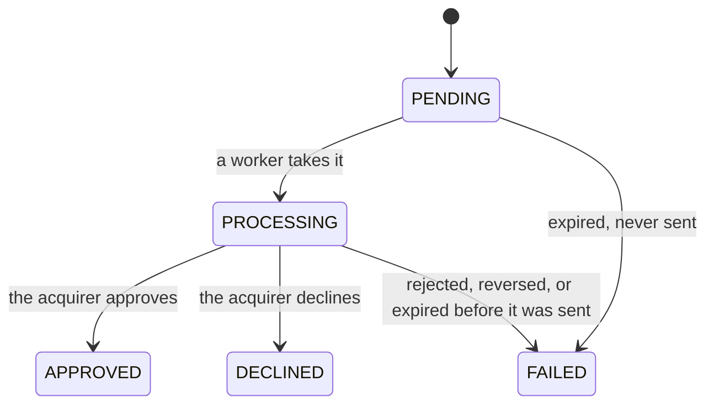

# PRD: Payment processing service

**Status:** draft for review · **Date:** 2026-10-28 · **Owner:** Oscar Núñez

## 1. Summary

A service that lets online merchants in Chile accept card payments. A merchant sends a payment; the service accepts it in milliseconds, has the acquirer authorize it in the background and tells the merchant the result by webhook. Every payment keeps its full history.

The engineering goal: no failure may charge a customer twice, lose an accepted payment, or tell the merchant something that did not happen. That holds whether an instance crashes, the acquirer is slow or unavailable, or Kafka is down.

This is the first iteration: authorization only, with one acquirer. What comes next is in the [roadmap](roadmap.md).

## 2. Problem

A merchant's checkout needs to charge a card without the merchant handling card data, and with the certainty that:

- a customer is never charged twice for the same purchase, even if the merchant retries or the customer clicks twice;
- an accepted payment always reaches a final result, even if something fails along the way;
- the merchant can explain every payment: what was asked, what the acquirer answered and when.

Acquirers are slow at times and unavailable at others, and a timeout does not say whether the card was charged. The service has to absorb that without blocking the merchant and without guessing.

## 3. Goals

1. Accept a payment in milliseconds, whatever the acquirer's latency, and resolve it in the background.
2. Zero double charges and zero lost payments, demonstrated with failure tests.
3. Horizontal scaling: more worker instances process more payments, up to the number of Kafka partitions.
4. The service never sees card numbers.
5. Every payment is traceable: its history in the database, and a single trace from the request to the webhook.

## 4. Non-goals in this iteration

- Capture, void and refunds: a payment is authorized or it is not.
- More than one acquirer, and routing between them.
- Ledger, settlement, reconciliation and payouts.
- Risk rules and fraud detection.
- Merchant onboarding, a merchant portal with login, and key rotation.
- Kubernetes, SLOs and metrics dashboards.
- 3-D Secure.

Each of them is in the [roadmap](roadmap.md), with what it would change.

## 5. Actors

| Actor | Role |
|---|---|
| Merchant | Its server creates and queries payments with a secret API key, and receives webhooks. Its checkout page runs in the cardholder's browser. |
| Cardholder | Enters the card in the merchant's checkout. |
| Acquirer | Simulated. Tokenizes cards from the browser, authorizes by idempotency key and reverses authorizations. Its latency and failures can be configured. |

## 6. Glossary

| Term | Meaning |
|---|---|
| Acquirer | The company that connects the service to the card networks and the issuers. |
| Authorization | The issuer approves the payment and holds the amount on the card. |
| Token | A reference to a card, created by the acquirer. It does not reveal the card number. |
| Reversal | Cancels an authorization whose outcome is unknown, for example after a timeout. After a reversal, the acquirer rejects any later authorization with the same key. |
| Idempotency key | A value the merchant chooses to identify one payment request. Repeating the request with the same key does not create a second payment. |
| Order | The merchant's purchase that a payment pays for (`order_id`). |
| Webhook | An HTTP call from the service to the merchant's server that reports an event. |
| RUT | Chile's tax id, with a check digit. |

## 7. Functional requirements

### Merchants

- **FR01** A merchant has a legal name, a RUT (validated with its check digit), a status (active or suspended) and a maximum amount per payment for each currency. In this iteration, merchants are loaded as seed data.
- **FR02** A merchant authenticates with a secret API key. The service stores only a hash of each key.
- **FR03** A suspended merchant cannot create payments, but it can still query them.
- **FR04** A merchant only sees its own payments: another merchant's payment answers `404`, as if it did not exist.

### Cards

- **FR05** The checkout tokenizes the card directly with the acquirer, from the browser. The service receives only the token: card numbers never reach its servers, its database or its logs.

### Payments

- **FR06** `POST /v1/payments` creates a payment for an order, with an `Idempotency-Key` header, the order id, the amount, the currency and the card token. A valid request answers `202` with the payment in `PENDING`. Invalid input answers `400` and a broken business rule answers `422`; neither creates anything.
- **FR07** Idempotency keys are unique per merchant and do not expire, because they are kept with the payment.
  - The same key with the same request answers `202` with the payment in its current state and the header `Idempotent-Replayed: true`.
  - The same key with a different request answers `422 idempotency_key_reused`.
  - Concurrent requests with the same key create exactly one payment.
- **FR08** An order has at most one payment that is pending, processing or approved. Paying such an order again, with another key, answers `409 order_has_active_payment`. After a decline or a failure, the order accepts a new payment with a new key.
- **FR09** A payment goes through `PENDING`, `PROCESSING` and one final state: `APPROVED`, `DECLINED` or `FAILED` (section 10). Final states never change. `APPROVED` and `DECLINED` are the acquirer's decision; `FAILED` is the service's, and it always carries a reason.
- **FR10** Payments are authorized in the background, with the payment id as the idempotency key towards the acquirer.
  - Temporary errors are retried, up to 3 attempts without a definite answer, with exponential backoff and jitter. They are a timeout, a lost connection, `5xx`, `408`, `429` or an unreadable answer.
  - A request the acquirer rejects, with any other `4xx`, ends `FAILED` with reason `acquirer_rejected`, without retries.
- **FR11** When the attempts run out and any of them may have reached the acquirer, the service reverses the authorization with the same key. It keeps trying until the acquirer confirms the reversal, and only then does the payment end `FAILED`, with reason `acquirer_unavailable`. A payment never ends `FAILED` while it may be authorized at the acquirer.
- **FR12** A payment that was not sent to the acquirer within 2 minutes of its creation ends `FAILED` with reason `expired`. That happens, for example, while Kafka or the acquirer is down. A charge that arrives after the customer has left the checkout is worse than a clear failure.
- **FR13** When the acquirer keeps failing, the service stops calling it for a while (a circuit breaker). Payments wait without spending attempts, and the service probes the acquirer before resuming.
- **FR14** `GET /v1/payments/{id}` returns a payment with its history. `GET /v1/payments` lists the merchant's payments, newest first, with filters by status and order id and cursor pagination.
- **FR15** Every status change and every call to the acquirer (attempt, outcome, latency and response code) is recorded in the payment's history, in the same transaction as the change.

### Webhooks

- **FR16** When a payment reaches a final state, the merchant receives a webhook signed with HMAC-SHA256 and a timestamp. Each event has an id, so the merchant can discard duplicates.
- **FR17** A failed delivery is retried with exponential backoff for 24 hours. After that, the delivery is marked failed; the merchant can still query the payment.

### Checkout and panel

- **FR18** A web app plays the merchant. It has a test checkout that tokenizes a card, pays an order and shows the result, and a panel with:
  - the payment list with its filters;
  - each payment's history;
  - the webhooks received;
  - controls to make the simulated acquirer slow or unavailable.

## 8. Non-functional requirements

| ID | Requirement |
|---|---|
| NFR01 | `POST /v1/payments` answers within 50 ms (p99) at the target load, whatever the acquirer's latency. |
| NFR02 | Target load: 500 payments per second sustained on one machine, with an acquirer that answers in 300 ms. Adding worker instances, up to the number of Kafka partitions, adds capacity. |
| NFR03 | If Kafka is down, the API keeps accepting payments. They are processed when Kafka comes back, or they expire (FR12). No event is lost. |
| NFR04 | If the acquirer is slow or down, accepting payments is not affected. |
| NFR05 | Any instance may stop at any moment without losing a payment or authorizing one twice. |
| NFR06 | The service never receives, stores or logs a card number. |
| NFR07 | A payment can be followed in a single trace from the request to the webhook, and its logs carry the payment id and the trace id. |
| NFR08 | Deployments lose no requests and no payments: graceful shutdown and backward-compatible migrations. |
| NFR09 | `docker compose up` starts everything locally, with no account or secret to set up. |

## 9. Business rules

- Amounts are integers in the currency's minor unit: CLP has no decimals and USD is in cents. The currencies are CLP and USD.
- The minimum amount is 1. The maximum per payment is set per merchant and currency; the seed data uses 5,000,000 CLP and 5,000 USD.
- An `Idempotency-Key` has 1 to 255 printable ASCII characters, and an `order_id` has 1 to 64.
- The acquirer validates the card (the Luhn check and the expiry date) when it tokenizes it. The service never sees those fields.
- Timestamps are stored in UTC.
- The values in FR10 to FR13 (3 attempts, 2 minutes, the breaker's thresholds) are assumptions, to be tuned to the acquirer's real behavior. The RFC lists them.

## 10. Payment lifecycle



- `PENDING`: accepted, and not taken by a worker yet.
- `PROCESSING`: a worker has it, and it may have reached the acquirer.
- `FAILED` reasons: `acquirer_rejected`, `acquirer_unavailable` (after a confirmed reversal) and `expired`.

## 11. Invariants

These are the guarantees the service must keep under any failure. Each one has a mechanism and a test in the [RFC](rfc/0001-architecture.md).

| ID | Invariant |
|---|---|
| INV01 | One idempotency key creates at most one payment per merchant. |
| INV02 | An order never has two payments that are pending, processing or approved. |
| INV03 | A payment is authorized at the acquirer at most once, and a payment that ends `FAILED` or `DECLINED` leaves no live authorization at the acquirer. |
| INV04 | Every accepted payment reaches a final state, or raises an alert. |
| INV05 | What the merchant is told, by the API or by webhook, matches the database and the acquirer's book. |
| INV06 | Every final state produces one webhook event, delivered at least once and always with the same event id. |

## 12. Acceptance scenarios

These scenarios become end-to-end tests.

```gherkin
Feature: No duplicate payments

  Scenario: Double click with the same key
    Given an active merchant
    When it sends the same payment 20 times at once with key "k1"
    Then exactly one payment exists
    And all 20 responses carry the same payment id

  Scenario: The same key with a different amount
    Given a payment created with key "k1" for 10,000 CLP
    When the merchant sends key "k1" for 12,000 CLP
    Then the response is 422 "idempotency_key_reused"

  Scenario: The same order while a payment is live
    Given an approved payment for order "o1"
    When the merchant pays order "o1" with key "k2"
    Then the response is 409 "order_has_active_payment"

  Scenario: A new attempt after a decline
    Given a declined payment for order "o2"
    When the merchant pays order "o2" with a new key and another card
    Then the payment is accepted

Feature: Acquirer failures

  Scenario: A temporary error
    Given the acquirer answers 503 to the first attempt only
    When a payment is made
    Then it ends APPROVED on the second attempt

  Scenario: A rejected request
    Given the acquirer answers 422 to the authorization
    When a payment is made
    Then it ends FAILED "acquirer_rejected" after a single attempt

  Scenario: Timeout with a late approval
    Given the acquirer approves but answers after the timeout
    When a payment is made
    Then the retry with the same key receives the same approval
    And the payment ends APPROVED with exactly one authorization at the acquirer

  Scenario: No answer at all
    Given the acquirer receives every attempt and never answers
    When a payment is made
    Then the service reverses the authorization
    And the payment ends FAILED "acquirer_unavailable" with no live authorization at the acquirer
    And a late authorization with the same key is rejected by the acquirer

  Scenario: The acquirer is down
    Given the acquirer refuses connections for 20 seconds
    When payments are made during that time
    Then the circuit breaker opens and the payments wait without spending attempts
    And once the acquirer is back, they end APPROVED

Feature: Service failures

  Scenario: A worker dies after sending
    Given a payment whose authorization was sent
    When the worker stops before recording the answer
    Then another worker takes the payment over
    And it ends APPROVED with exactly one authorization at the acquirer

  Scenario: The database fails after the approval
    Given the acquirer approved a payment
    When recording the approval fails
    Then the call is repeated with the same key and the payment ends APPROVED

  Scenario: Kafka is down for a short while
    Given Kafka is unavailable for 30 seconds
    When merchants make payments during that time
    Then every request answers 202
    And once Kafka is back, every payment reaches a final state

  Scenario: Kafka is down for longer than the expiry
    Given Kafka is unavailable for 3 minutes
    When merchants make payments at the start of the outage
    Then those payments end FAILED "expired"
    And none of them reached the acquirer

Feature: Webhooks

  Scenario: The merchant's endpoint is down
    Given the merchant's endpoint answers 500
    When a payment is approved
    Then the webhook is retried with increasing delays
    And once the endpoint recovers, it receives the signed event with the same event id

Feature: Merchants

  Scenario: A suspended merchant
    Given a suspended merchant
    When it creates a payment
    Then the response is 422 "merchant_suspended"

  Scenario: Another merchant's payment
    Given a payment of merchant "m1"
    When merchant "m2" asks for it
    Then the response is 404
```

## 13. How it will be proven

- Unit tests of the domain: the state machine, the classification of the acquirer's answers and the backoff.
- Integration tests against real Postgres and Kafka, with testcontainers.
- The acceptance scenarios above, as end-to-end tests against the full local environment, using the fault controls of the acquirer simulator.
- A consistency checker. After a load test with faults, it compares every payment in the database with the acquirer simulator's book and with the webhooks received, and checks INV02 to INV06.
- A load test with k6 for NFR01 and NFR02. The README reports what was measured, and on which machine.

## 14. Delivery

The RFC splits the work into pull requests (section 17). The README marks each capability as designed, implemented or proven.

## 15. Assumptions

- The acquirer is simulated, with its contract documented in the RFC.
- One country (Chile) and two currencies, with no conversion between them.
- The acquirer's tokenization is the only way a card enters the system, so the service never receives card data and its PCI scope stays minimal.

## 16. Open questions

- Should `POST /v1/payments` wait a few seconds for the result, so a checkout gets it in the same response? Proposal: not in this iteration; the checkout polls. It is in the roadmap.
