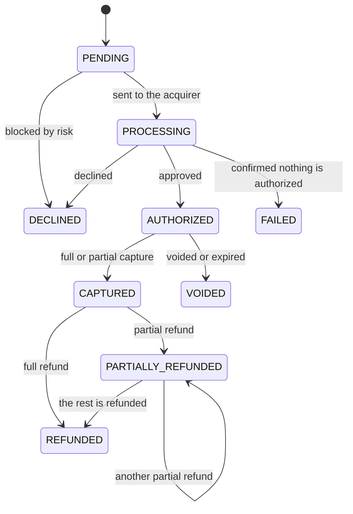

# PRD: Payments platform for merchants

**Status:** draft for review · **Date:** 2026-10-28 · **Owner:** Oscar Núñez

## 1. Summary

A payment service provider (PSP) that lets online merchants in Chile accept card payments. It works as a payment facilitator: to the acquirers it is a single merchant, and it pays each of its sub-merchants. The platform authorizes and captures payments through two acquirers, handles refunds, records every money movement in a double-entry ledger, reconciles what the acquirers settle against what reaches the bank, and pays each merchant on its schedule.

The engineering goal: no failure may lose or duplicate money without being detected, and the platform must scale horizontally to the traffic peaks of sales events such as CyberDay in Chile.

## 2. Problem

A merchant needs to accept cards without integrating with each acquirer, without handling card data, and with the certainty that:

- a customer is never charged twice for the same purchase;
- an accepted payment is never lost, even if something fails along the way;
- the merchant gets paid on time and can explain every peso: what was charged, what was refunded, which fees and taxes were deducted and what was paid out.

The platform, in turn, has to work with acquirers that fail in different ways, reconcile what each one says it settled with what actually reached the bank, and catch any difference before it reaches the merchant.

## 3. Goals

1. End-to-end card payments: authorization, capture, void and refund.
2. Zero duplicate charges and zero lost payments, demonstrated under failures.
3. Traceable money: every movement in an immutable ledger that always balances.
4. Complete daily reconciliation with the acquirers and the bank.
5. Horizontal scaling to peaks of 3,000 TPS, with authorization independent from downstream systems.
6. Minimal PCI scope: only the vault sees card data.
7. Chilean rules modeled as they are: RUT, installments, IVA, time zone, business days and public holidays.

## 4. Non-goals

- 3-D Secure and cardholder authentication.
- Network tokens.
- Other payment methods: bank transfers and wallets.
- Physical point-of-sale terminals.
- Fraud detection with machine learning models.
- Active-active multi-region.
- Automated merchant onboarding (KYC) and electronic invoicing of fees (DTE).

## 5. Actors

| Actor | Role |
|---|---|
| Merchant | Integrates through the API; charges, captures, voids and refunds. Its users work in the portal with roles. |
| Cardholder | Pays in the merchant's checkout. |
| Acquirer A | Authorizes over HTTP/JSON, with idempotency keys, status inquiry and reversal. Settles at T+1. |
| Acquirer B | Authorizes over ISO 8583 on TCP, with trace numbers and 0400 reversals. Settles at T+2. |
| Platform bank | Receives the settlements, executes the payouts and sends a daily statement (simulated). |
| Operations | Reviews merchants, resolves reconciliation exceptions, manages disputes, monitors the acquirers and replays failed messages. Sensitive actions need two operators. |

## 6. Glossary

| Term | Meaning |
|---|---|
| Authorization | The issuer holds the amount on the card. No money moves yet. |
| Capture | Confirms an authorization; from then on, the acquirer owes the money. |
| Sale | Authorization and capture in a single step. |
| Void | Cancels an authorization before capture and releases the hold. |
| Reversal | Undoes an authorization whose outcome is unknown, for example after a timeout. |
| Refund | Returns all or part of a captured payment to the cardholder. |
| Installments | A credit card payment split into monthly charges (*cuotas*). Regular installments are funded by the issuer; interest-free installments are funded by the merchant through a higher fee. |
| Settlement | The acquirer pays the platform for captured payments and reports it in a daily file. |
| Reconciliation | Matching what the platform recorded against what the acquirer settled and what reached the bank. |
| Bank statement | The daily list of movements in the platform's bank account (*cartola*). |
| Payout | The platform pays the merchant. |
| Rolling reserve | A share of each payout held for a period, to cover future refunds and disputes. |
| Dispute | The cardholder contests a charge with their bank (a chargeback); the amount is debited from the merchant while it is resolved. |
| Payment facilitator | A platform that is a single merchant to the acquirers and processes payments on behalf of its sub-merchants. |
| RUT | Chile's tax id for people and companies, with a check digit. |
| MCC | Merchant category code: four digits that classify the merchant's business for the card networks. |
| Statement descriptor | The text the cardholder sees on their card statement. |
| MDR | The fee the platform charges the merchant for each payment. |
| IVA | Chile's value-added tax, 19%, charged on top of every fee. |
| PAN, BIN | The card number, and its first 6 or 8 digits, which identify the issuer. |
| Token | A reference to a card stored in the vault; it does not reveal the number. |
| Fingerprint | A stable hash of a card, used to recognize it without knowing its number. |
| Maker-checker | A control where one operator requests a sensitive change and a different operator approves it. |

## 7. Functional requirements

### Merchants

- **FR01** A merchant has a profile: RUT (validated with its check digit), legal name, trade name, business activity, MCC, and the statement descriptor its customers will see.
- **FR02** A merchant goes through a lifecycle: in review, active, suspended and closed. Only active merchants can create payments. A suspended merchant can still refund, and its payouts are held.
- **FR03** Each merchant has a fee plan, limits per payment and per day for each currency, a payout schedule (daily or weekly) with a minimum amount, and an optional rolling reserve.
- **FR04** The payout bank account must belong to the merchant's own RUT. Adding or changing it requires a second approval (FR48).
- **FR05** Each merchant has secret API keys, for its servers, and publishable keys, only for tokenizing cards from the browser. Keys can be rotated with an overlap period in which both the old and the new key work.
- **FR06** A merchant's users have roles: owner, finance, developer and support.
- **FR07** A merchant can only see and act on its own resources.
- **FR08** The platform acts as a payment facilitator: with every authorization, it sends the acquirer the sub-merchant's id, MCC and statement descriptor.

### Cards

- **FR09** The checkout collects the card in a field hosted by the vault (an iframe). Neither the merchant's page nor its servers see the number.
- **FR10** A PCI-compliant merchant may send the card from its server. The vault replaces it with a token before it reaches the rest of the platform.
- **FR11** A card can be single-use or saved for future payments to the same merchant. The CVV is never stored: it is discarded when the first authorization finishes, or after 10 minutes.
- **FR12** A BIN table identifies each card's brand, type (credit, debit or prepaid), issuer and country. It drives routing, fees and risk rules.

### Orders and payments

- **FR13** Every payment belongs to a merchant order (`order_id`) with a fixed amount and currency. An order has at most one live or approved payment. If a payment ends declined, failed or voided, the order accepts a new attempt; a refunded order does not, and the merchant creates a new one.
- **FR14** With a credit card, the merchant can authorize and capture later, or make a sale in one step. Debit and prepaid cards only accept sales.
- **FR15** Credit card payments can be split into installments. The merchant chooses the number of installments and who funds them: the issuer (regular installments) or the merchant (interest-free installments). Debit and prepaid cards do not accept installments.
- **FR16** Authorization returns the final result in the same call. If the acquirer does not answer within the call's time budget, the response is `202` with the payment in progress, and a webhook reports the result once it is resolved.
- **FR17** Capture can be full or partial, once per payment. The rest of the authorization is released.
- **FR18** The merchant can void an uncaptured authorization. Uncaptured authorizations are voided automatically after 7 days.
- **FR19** Every operation that creates or changes something (payment, capture, void, refund) requires an `Idempotency-Key`. Repeating a request with the same key returns the same response; the same key with different content is rejected.
- **FR20** A payment accepts merchant metadata (key-value pairs) and a dynamic suffix for the statement descriptor, such as the order number.
- **FR21** The merchant can fetch a payment by id, and list its payments with filters (status, order, dates) and cursor pagination.
- **FR22** Each payment has a history: every status change and every call to the acquirer, with its result and its latency.

### Routing and acquirers

- **FR23** The platform chooses the acquirer by card brand, card type, cost and health, and never sends an acquirer more transactions per second than it accepts.
- **FR24** If the chosen acquirer certainly did not process the request (connection refused, or its circuit breaker is open), the platform fails over to the other acquirer. If the outcome is uncertain (a timeout), the platform first queries the same acquirer and, if it is still uncertain, sends a reversal. Only once it is confirmed that no live authorization exists may the platform try the other acquirer.

### Refunds

- **FR25** A captured payment accepts several partial or full refunds, never exceeding the captured amount. Refunds are processed asynchronously and reported by webhook.

### Money

- **FR26** Every money movement (capture, fee, tax, refund, settlement, dispute, reserve, payout) is recorded as an immutable double-entry journal entry.
- **FR27** Each merchant has a pending balance (captured, not yet settled by the acquirer), an available balance (settled and ready to be paid out), a reserved balance, and a breakdown of fees and taxes.
- **FR28** Fees depend on the card type and on interest-free installments, and IVA is charged on top of every fee. A refund does not return the fee. A dispute carries a fixed fee.
- **FR29** Corrections are manual adjustments: new journal entries with a reason, which require a second approval (FR48). Entries are never edited or deleted.

### Settlement and reconciliation

- **FR30** Each acquirer delivers a daily file with the settled payments and refunds: gross amount, acquirer fee, the IVA on that fee, and net amount. The file has a header and a trailer with the record count and totals. A file whose trailer does not match its lines is rejected, and loading the same file twice has no effect.
- **FR31** The platform matches each line against its own records. Matched lines move the money from pending to available. Unmatched lines (missing in the file, missing in the platform, or with a different amount) go to an exception queue that operations must resolve.
- **FR32** A captured payment that does not appear settled within the acquirer's term plus one business day raises an exception.
- **FR33** The platform loads the bank statement every day and checks that each acquirer's net settlement arrived. A missing or different deposit raises an exception.

### Payouts

- **FR34** Payouts follow each merchant's schedule. A payout includes exactly what happened before its cut-off time: it waits until the ledger has recorded every event up to the cut-off. A negative balance is deducted from the next payouts, an amount below the minimum rolls over, and the platform produces the transfer file for the bank.
- **FR35** A rolling reserve is released when its holding period ends. Releasing it earlier requires a second approval (FR48).
- **FR36** A payout rejected by the bank returns the amount to the available balance, and the merchant is notified.

### Disputes

- **FR37** The acquirer reports disputes with a reason code. The platform debits the amount and the dispute fee from the merchant, notifies the merchant, and lets it upload evidence before the deadline.
- **FR38** If the dispute is won, the amount is credited back; if it is lost, it stays debited.

### Risk

- **FR39** Before authorizing, the platform evaluates rules: velocity per card, merchant and IP; blocklists of fingerprints and BINs; card country; and amount limits.
- **FR40** The platform detects card testing (many different cards, low amounts and repeated declines from the same source) and blocks the source for a period of time.
- **FR41** Every risk decision is recorded with the rule that produced it.
- **FR42** Risk counters include the payment being evaluated and every earlier one, as they happen. They keep working when Kafka is down.

### Webhooks

- **FR43** The platform notifies each endpoint of the events it subscribed to, signed with HMAC-SHA256 and a timestamp.
- **FR44** A failed delivery is retried with increasing delays for 3 days. An endpoint that keeps failing for that whole period is disabled, and the merchant is notified. The merchant can resend any event.

### Portal and console

- **FR45** Merchant portal: payments with their history, refunds, balances, payouts, disputes, webhooks with their deliveries, API keys and users. It includes a test checkout and downloadable reports: settlements per day and a monthly statement.
- **FR46** Operations console: merchant review, reconciliation exceptions, disputes, the health of each acquirer, and failed messages with replay.
- **FR47** The portal and the console require login (OIDC) with roles. Every action taken by operations is audited.
- **FR48** Sensitive operations need two different operators (maker-checker): adding or changing a payout bank account, manual adjustments, releasing a reserve early, and reactivating a suspended merchant.

## 8. Non-functional requirements

| ID | Requirement |
|---|---|
| NFR01 | 99.95% monthly availability for authorization, capture and void. |
| NFR02 | The platform adds at most 50 ms (p99) on top of the acquirer's latency. Reads respond in under 100 ms (p99). |
| NFR03 | 300 TPS on average and peaks of 3,000 TPS for one hour, scaling horizontally. |
| NFR04 | RPO 0 for payments and the ledger; RTO under 1 minute when the primary database fails. |
| NFR05 | If Kafka or any of its consumers goes down, authorization keeps working. When they come back, they catch up without losing events. |
| NFR06 | If an acquirer goes down, traffic fails over to the other one whenever it is safe (FR24). |
| NFR07 | Only the vault processes and stores card data. It stores it encrypted, with keys that can be rotated. |
| NFR08 | Services talk to each other over mutual TLS, and the vault's zone is isolated at the network level. |
| NFR09 | Every payment can be followed end to end in a single trace, and its logs share the payment id and the correlation id. |
| NFR10 | Every SLO has a dashboard and error-budget burn-rate alerts, and every alert has a runbook. |
| NFR11 | Deployments do not interrupt the service: rolling deployments and backward-compatible migrations. |
| NFR12 | Events have versioned contracts, and an incompatible change is caught before merge. |
| NFR13 | One merchant cannot degrade the others: each merchant has rate limits, and excess load is shed early with `429` or `503` and `Retry-After`. |
| NFR14 | Personal data is kept to a minimum: the cardholder's name and email are stored only when needed and for a defined period, and saved cards are deleted on request or after a period of inactivity, in line with Chile's personal data protection law (Ley 21.719). |

## 9. Business rules

- Amounts are integers in the currency's minor unit: CLP has no decimals and USD is in cents. The currencies are CLP and USD, with no conversion between them, and the ledger keeps each currency separate.
- Each merchant has a maximum amount per payment and per day, for each currency.
- A RUT is valid only if its check digit matches (modulo 11).
- An expired card or an invalid card number (Luhn check) is rejected by the vault, before it reaches the rest of the platform.
- A capture cannot exceed the authorized amount, and an authorization expires after 7 days without a capture.
- Debit and prepaid cards only accept sales, without installments. Credit cards accept between 2 and 36 installments by default.
- Refunds add up to at most the captured amount, and are accepted only within 180 days of the capture.
- IVA is 19% of each fee, rounded to the nearest peso.
- Timestamps are stored in UTC. Cut-off times, business days and settlement dates follow Chile's time zone (America/Santiago), including the days when the clocks change.
- Business days are Monday to Friday, except Chilean public holidays, which the platform keeps as a calendar. Settlement terms (T+1, T+2) count business days.
- The payout cut-off is 14:00 Chile time and the minimum payout is 1,000 CLP, both configurable.
- The deadline to submit evidence for a dispute is 7 days.
- Idempotency keys are kept for at least 30 days.

## 10. Lifecycles

### Payment



- `PENDING` means the payment was never sent to an acquirer; `PROCESSING` means it may have reached one.
- `FAILED` guarantees that no live authorization remains at any acquirer. While a reversal is pending, the payment stays `PROCESSING`.
- A sale, including every debit and prepaid payment, goes through `AUTHORIZED` and `CAPTURED` automatically.

### Other lifecycles

- **Merchant:** `IN_REVIEW` → `ACTIVE` → `SUSPENDED` → `ACTIVE` again (with a second approval) or `CLOSED`.
- **Payout bank account change:** `PENDING_APPROVAL` → `APPROVED` or `REJECTED`.
- **Refund:** `PENDING` → `SUCCEEDED` or `FAILED`.
- **Payout:** `SCHEDULED` → `SENT` → `PAID` or `RETURNED`.
- **Dispute:** `OPEN` → `EVIDENCE_SUBMITTED` → `WON` or `LOST`. An `OPEN` dispute with no evidence by the deadline ends `LOST`.

## 11. Invariants

These are the guarantees the platform must keep under any failure. Each one has a mechanism and a test in the architecture RFC.

| ID | Invariant |
|---|---|
| INV01 | An order never has two live authorizations, across all acquirers. |
| INV02 | No accepted payment is lost: every payment reaches a final state or raises an alert. |
| INV03 | What the platform tells the merchant matches what was recorded and what the acquirer did. |
| INV04 | Every ledger entry sums to zero, and entries are never modified. |
| INV05 | Per merchant and currency: captured − refunded − fees − taxes − disputes (net of disputes won) = paid out + pending + available + reserved. |
| INV06 | A payment is never refunded beyond its captured amount. |
| INV07 | Every settled line is reconciled or sits in the exception queue; every captured payment appears settled within its term or raises an exception; every acquirer settlement appears in the bank statement or raises an exception. |
| INV08 | No card data leaves the vault: it never appears in Kafka, in other databases or in logs. |
| INV09 | Every event reaches each of its consumers, possibly more than once, and processing it twice does not change the result. |
| INV10 | A payout pays exactly what happened before its cut-off: nothing is paid twice or left out. |
| INV11 | No sensitive operation is completed by a single person. |

## 12. Acceptance scenarios

These scenarios will become executable tests. Thresholds such as the card testing limits are examples; the rules are configurable.

```gherkin
Feature: No duplicate charges

  Scenario: Double click with the same key
    Given an active merchant
    When it sends the same payment 20 times at once with key "k1"
    Then exactly one payment exists
    And all 20 responses carry the same payment id

  Scenario: Same order with another key while a payment is live
    Given an authorized payment for order "o1"
    When the merchant pays order "o1" with key "k2"
    Then the response is 409 "order_has_active_payment"

  Scenario: Timeout with a late approval
    Given acquirer A approves but answers after the timeout
    When the merchant pays order "o2"
    Then the platform queries acquirer A
    And the payment ends AUTHORIZED with exactly one authorization at A

  Scenario: Timeout with no answer
    Given acquirer A answers neither the authorization nor the inquiry
    When the merchant pays order "o3"
    Then the platform sends reversals to A until one is confirmed
    And the payment ends FAILED with no live authorization

  Scenario: Safe failover
    Given acquirer A refuses connections
    When the merchant pays order "o4"
    Then the payment is authorized by acquirer B

  Scenario: No failover while in doubt
    Given acquirer A receives the authorization and never answers
    When the merchant pays order "o5"
    Then the platform sends nothing to B until the payment is resolved at A

  Scenario: The instance dies after sending
    Given a payment sent to acquirer A
    When the instance processing it stops before saving the answer
    Then another instance takes it over when its lease expires
    And the payment reaches its final state with exactly one authorization at A

Feature: Merchants

  Scenario: Suspended merchant
    Given a suspended merchant with a captured payment
    When it creates a new payment
    Then the response is 403 "merchant_suspended"
    But a refund of the captured payment is accepted

  Scenario: Changing the payout bank account
    Given operator "ana" requests a new bank account for a merchant
    When "ana" approves her own request
    Then the approval is rejected
    And when operator "luis" approves it, the new account takes effect

Feature: Cards and installments

  Scenario: Installments on a debit card
    Given a debit card
    When the merchant pays in 3 installments
    Then the response is 422 "installments_not_allowed"

  Scenario: Fee with IVA
    Given a merchant with a 2.9% fee for credit cards
    When a credit card payment of 10,000 CLP is captured
    Then the merchant is charged a fee of 290 CLP plus 55 CLP of IVA

Feature: Refunds

  Scenario: Concurrent refunds beyond the captured amount
    Given a payment captured for 10,000 CLP
    When two refunds of 6,000 CLP are requested at the same time
    Then one is accepted and the other is rejected with 422 "refund_exceeds_captured"

Feature: Reconciliation

  Scenario: Line with a different amount
    Given a payment captured for 10,000 CLP
    And acquirer A's file reports it as 9,000 CLP
    When the file is reconciled
    Then the line goes to the exception queue
    And the money does not become available

  Scenario: Payment never settled
    Given a payment captured at acquirer A on a Monday
    And no file from A includes it by Wednesday
    Then a "settlement_missing" exception is raised

  Scenario: File with a wrong trailer
    Given a settlement file whose trailer says 100 lines but which has 99
    When the file is loaded
    Then it is rejected and none of its lines is processed

  Scenario: The same file twice
    Given a settlement file that was already loaded
    When it is loaded again
    Then nothing changes

Feature: Payouts

  Scenario: Payout with a negative balance
    Given a merchant with an available balance of -5,000 CLP
    And settlements of 20,000 CLP for the day
    When the daily payout runs
    Then the merchant is paid 15,000 CLP

  Scenario: The payout waits for the ledger
    Given a refund made at 13:59 that the ledger has not recorded yet
    When the 14:00 payout runs
    Then the payout waits until the refund is recorded
    And the amount paid already deducts it

  Scenario: The day the clocks change
    Given the day Chile moves its clocks back, which lasts 25 hours
    When the payout for that day runs
    Then it includes every event of those 25 hours exactly once

Feature: Resilience

  Scenario: Kafka is down
    Given Kafka is unavailable
    When merchants make payments for 5 minutes
    Then the payments are authorized normally
    And when Kafka is back, the ledger records every entry with no duplicates

  Scenario: A noisy merchant
    Given merchant "m1" sends ten times its rate limit
    Then its excess requests get 429 with Retry-After
    And the other merchants' latency stays within NFR02

Feature: Risk

  Scenario: Card testing
    Given 30 payments of 100 CLP with 30 different cards arrive from the same IP within 2 minutes
    Then the IP is blocked for 24 hours
    And later payments from that IP are declined without reaching any acquirer

  Scenario: Card testing while Kafka is down
    Given Kafka is unavailable
    When the same 30 payments arrive
    Then the IP is blocked all the same

Feature: Webhooks

  Scenario: Endpoint down
    Given an endpoint that responds 500
    When an event occurs
    Then the delivery is retried with increasing delays
    And once the endpoint recovers, it receives the signed event

Feature: Card data

  Scenario: Card data never leaves the vault
    Given 10,000 payments were processed with test cards
    When Kafka, the databases outside the vault and the logs are scanned
    Then no card number is found
```

## 13. How it will be proven

- A TLA+ model of the authorization protocol, checked with TLC (INV01, INV02).
- Property-based tests for the payment state machine and the ledger (INV04 to INV06, INV10).
- An invariant checker under failure: load with k6 plus fault injection with Toxiproxy and Chaos Mesh, comparing what each client saw with the database and with the books of the simulated acquirers (INV01 to INV03, INV07).
- A scan for card data (INV08) and chaos tests on Kafka (INV09).
- A data and traffic generator: merchants with valid RUTs, test BINs, a daily traffic curve, a CyberDay peak, a card testing attack and disputes. It feeds the demos and the load tests.
- Load tests: steady state, a 10x peak and a 2-hour soak.
- Drills: failure of the primary database, loss of a Kafka broker, an acquirer outage and a point-in-time restore.

A local environment demonstrates the shape of the system: horizontal scaling and its behavior under failure. The absolute figures in NFR03 depend on production hardware.

## 14. Milestones

| Milestone | Scope |
|---|---|
| 1. Reliable core | FR01–FR22 and FR39–FR42 with acquirer A; NFR07, NFR09, NFR12 and NFR13; the TLA+ model |
| 2. Money adds up | FR23–FR36 and FR48: acquirer B and routing, refunds, ledger, fees and IVA, settlement, reconciliation with the bank, payouts and reserves |
| 3. Merchant and operations | FR37–FR38 and FR43–FR47, NFR14: disputes, webhooks, portal, console and personal data |
| 4. Production | NFR01–NFR06, NFR08, NFR10 and NFR11: Kubernetes, observability, load, chaos and drills |

Until webhooks arrive in milestone 3, a merchant follows up a `202` with `GET`.

## 15. Assumptions

- The acquirers, the bank and their files are simulated, with contracts documented in this repository and configurable failures.
- One country (Chile) and two currencies.
- The acquirers settle installment payments in full: the merchant receives the whole amount, minus fees.
- Acquirer fees and their IVA come in the settlement files; the platform does not compute them.
- Merchants are onboarded through the console with a manual review; there is no automated KYC.
- The registrations a real payment facilitator needs are outside the scope of the software.

## 16. Open questions

- Multiple partial captures per authorization? Proposal: not in this version.
- Separate test and live modes, like Stripe's test and live keys? Proposal: no, since everything runs against simulators.

### Possible extensions

If time allows after milestone 3, in this order:

1. Payment links: a hosted page to pay an order from a link, common among small merchants.
2. Email receipts for the cardholder.
3. A manual review queue for suspicious payments.
4. Monthly fee invoices (DTE) through an electronic invoicing provider.
5. Several stores per merchant.
