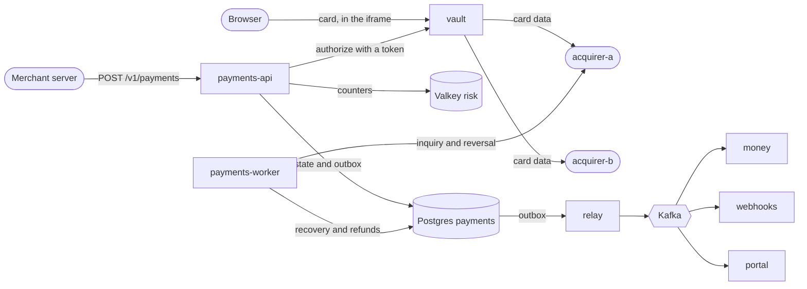

# RFC 0001: Platform architecture

**Status:** draft for review · **Date:** 2026-10-28 · **Owner:** Oscar Núñez · **Requirements:** [PRD](../prd.md)

## 1. Summary

This RFC describes how the platform in the PRD is built. It covers the whole architecture and goes into detail for milestone 1. Each later milestone extends this document before its code starts.

In one paragraph: authorization is synchronous and durable. Every call that can move money is written to Postgres before it is sent, so a crash never leaves an unknown that cannot be resolved. Postgres enforces every guarantee. Kafka carries facts that already happened to the services downstream, and it is not on the path of a payment. Only the vault sees card data. Ledger, reconciliation and payouts live in one service because they move the same money.

## 2. Principles

1. **Postgres decides, Kafka carries.** Every guarantee is a constraint or a conditional statement in Postgres. Kafka distributes events after they are committed.
2. **The payment path depends on as little as possible:** Postgres, Valkey, the vault and the acquirer. Never on Kafka or on a downstream service.
3. **Write before acting.** Every acquirer call is recorded, with its idempotency key, before it is sent.
4. **When in doubt, ask.** An uncertain outcome is resolved by asking the same acquirer: first an inquiry, then a reversal. The platform never guesses, and never tries a second acquirer while the first one may have approved.
5. **Group by consistency boundary.** Data that must change together lives in the same service and database.
6. **Facts travel on Kafka; work waits in Postgres.** Events go to Kafka. Work with deadlines or delays (recovery, refunds, expirations, webhook retries) is stored as rows in the database of the service that owns it.
7. **Every guarantee has a test, and nothing is claimed before it is proven.**

## 3. Components

| Component | Responsibility | State | Milestone |
|---|---|---|---|
| `payments-api` | Public API for payments, captures, voids and refunds. Idempotency, orders, the authorization protocol, routing, risk rules and rate limits. Owns merchants. | Postgres `payments`, Valkey `risk` | 1 |
| `payments-worker` | Recovery of uncertain operations, refunds, automatic voids and risk analytics. Same codebase and database as the API. | Postgres `payments` | 1 |
| `vault` | Hosted card field, tokens, saved cards, CVV, and the forward proxy that adds card data to acquirer requests. The only component in PCI scope. | Postgres `vault`, Valkey `vault` | 1 |
| `relay` | Publishes a database's outbox to Kafka, in order. One instance is active per database. | none | 1 |
| `money` | Ledger, fee and IVA postings, settlement files, reconciliation with the bank statement, payouts and reserves. | Postgres `money` | 2 |
| `webhooks` | Delivers events to merchant endpoints, with retries. | Postgres `webhooks` | 3 |
| `portal` | Next.js app: test checkout (milestone 1), merchant portal and operations console (milestone 3). Live updates over SSE. | none | 1, 3 |
| `acquirer-a` | Simulator over HTTP/JSON with idempotency keys, inquiry and reversal, configurable latency and failures, and its own book of authorizations. | memory and files | 1 |
| `acquirer-b` | Simulator over ISO 8583 on TCP. | memory and files | 2 |
| `bank` | Simulator that receives transfer files and produces daily statements. | files | 2 |
| `datagen` | Generates merchants, cards and realistic traffic. | none | 1 |

Infrastructure:

- One Postgres cluster, with one database and one role per service.
- Kafka in KRaft mode: one broker locally, three in milestone 4.
- Two Valkey instances: one for risk counters, and the vault's own, inside the PCI zone.
- Keycloak for OIDC, from milestone 3.
- OpenTelemetry Collector, Jaeger and Prometheus from milestone 1; Grafana, Tempo and Loki in milestone 4.

## 4. Architecture



Everything left of Postgres happens inside the merchant's request. Everything right of the relay happens after the response. If Kafka is down, payments keep working and the outbox grows until it comes back.

## 5. Authorization protocol

### 5.1 The normal path

1. **Checks, risk and limits.** `payments-api` authenticates the API key, checks that the merchant is active and that the amount is within its per-payment limit, and runs one Valkey script that updates and reads every risk counter and rate limit (section 10). If no acquirer can take the payment (circuit breakers open or caps reached), it answers `503` with `Retry-After` and creates nothing.
2. **Transaction T1.** In a single transaction:
   - insert the idempotency record (section 6);
   - insert the order if it is new, or check that its amount and currency match;
   - insert the payment as `PENDING`;
   - insert the acquirer operation `authorize` with status `SENDING`, a lease, and its own id, which is the idempotency key the acquirer receives, and move the payment to `PROCESSING`;
   - insert the risk decision, the events and the outbox rows.

   If risk declined the payment, T1 moves it from `PENDING` to `DECLINED` instead, and nothing is sent.
3. **The call.** `payments-api` asks the vault to forward the authorization. The vault adds the card data and calls the acquirer. No database connection is held while waiting.
4. **Transaction T2.** A conditional update moves the operation from `SENDING` to its result and the payment from `PROCESSING` to `AUTHORIZED` or `DECLINED`. It inserts the event and the outbox row, and stores the final response in the idempotency record. If the conditional update finds that recovery already resolved the operation, the API answers with that result instead.
5. **The response.** Only after T2 commits does the merchant receive `201` with the final state.

A sale, and every debit or prepaid payment, sends the authorization with the capture flag and ends `CAPTURED` in the same request.

### 5.2 Time budget

| Limit | Initial value |
|---|---|
| Request deadline | 8 s (a merchant may lower it with `Prefer: wait=N`, RFC 7240) |
| Acquirer call timeout | 5 s |
| Inquiry timeout | 1 s |
| Operation lease | 15 s |
| Recovery scan | every 2 s |
| Graceful shutdown | 20 s |
| Kubernetes termination grace | 30 s |

The chain is 5 + 1 < 8 < 15 < 20 < 30. When the deadline passes, the merchant gets `202` with the payment in `PROCESSING`. The call keeps going in the background, bounded by its own timeout, and finishes with T2 as usual. If the instance dies, the lease expires and recovery takes over.

Postgres sessions use a 2 s statement timeout and a 5 s idle-in-transaction timeout, so no transaction can hold locks while an acquirer is slow.

### 5.3 Uncertain outcomes

| What happened | Classification | What the platform does |
|---|---|---|
| The acquirer answered | Definite | Records the approval or the decline. |
| Connection refused, circuit breaker open, or the vault reports `not_sent` | Not sent | Marks the operation `NOT_SENT`. From milestone 2 it may fail over (section 5.4). |
| Timeout, connection reset after sending, or an unreadable answer | Uncertain | Sends an inquiry by key. If it is still uncertain, the operation becomes `UNKNOWN` and recovery takes it. |
| The instance died | Uncertain, found when the lease expires | Recovery sends an inquiry by key. |

Recovery runs in `payments-worker`. Every 2 s it claims operations in `SENDING` or `UNKNOWN` whose lease expired, using `FOR UPDATE SKIP LOCKED`, renews the lease and asks the same acquirer:

- **Approved or declined:** records that result.
- **Not found:** the request never arrived. If the card data is still in the vault, recovery resends the authorization with the same key; otherwise the payment ends `FAILED`, since nothing reached the acquirer.
- **No answer:** it retries the inquiry with backoff. After three failed inquiries, it sends reversals until one is confirmed, and the payment ends `FAILED` with reason `reversed`.

An operation that stays unresolved for more than 5 minutes raises an alert.

### 5.4 Failover (milestone 2)

The router may only move to the other acquirer when the current operation is `NOT_SENT` or confirmed `REVERSED`. A unique index allows only one live authorization operation per payment (section 7), so a second authorization cannot even be inserted while the first one is uncertain.

Acquirer B speaks ISO 8583, which has no idempotency keys. Its simulator detects duplicates by trace number and date, as real acquirers do, and the reversal message (0400) plays the role of the reversal by key.

### 5.5 Capture, void and automatic void

- **Capture and void** follow the same write-ahead pattern: an operation row first, then the call, then a conditional update. The payment row is locked during T1, and a unique index allows only one pending capture or void per payment, so a capture and a void can never race.
- **Automatic void:** `payments-worker` sweeps every minute for payments that have been `AUTHORIZED` for 7 days and voids them with the same flow.

### 5.6 Refunds (milestone 2)

`POST /v1/payments/{id}/refunds` locks the payment row and checks that the captured amount covers the refunds already succeeded or pending plus the new one. It inserts the refund as `PENDING` with its operation row and answers `202`. `payments-worker` claims pending refund operations from Postgres and calls the acquirer. Refunds therefore keep working when Kafka is down.

## 6. Idempotency

Every `POST` that creates or changes something uses one table, keyed by merchant and `Idempotency-Key`:

| Column | Purpose |
|---|---|
| `merchant_id`, `key` | Primary key |
| `request_hash` | Hash of the canonical request. It uses the card fingerprint, not the token, so a retry through the vault proxy is still recognized. |
| `status` | `in_progress` or `completed` |
| `resource_id` | The payment or refund the key created |
| `response_code`, `response_body` | The final response, stored in T2 |
| `expires_at` | 30 days after creation; a daily job deletes expired keys |

Behavior:

| Request | Response |
|---|---|
| New key | Processed normally |
| Same key, same request, already completed | The stored response, with `Idempotent-Replayed: true` |
| Same key, same request, still in progress | `202` with the resource in its current state |
| Same key, different request | `422 idempotency_key_reused` |

Concurrent duplicates wait on the primary key until the first transaction commits, then follow the table above. This is what makes the double-click scenario return the same payment id twenty times.

## 7. Data model (payments database, milestone 1)

| Table | Purpose |
|---|---|
| `merchants` | Profile, RUT, MCC, descriptor, status, limits, fee plan, payout settings and reserve |
| `merchant_users` | Portal users with their roles |
| `api_keys` | Secret and publishable keys, stored as a prefix plus a hash, with rotation dates |
| `fee_plans` | Fees per card type and for interest-free installments |
| `bin_ranges` | Brand, card type, issuer and country per BIN range |
| `orders` | One row per merchant order, with its fixed amount and currency |
| `payments` | The payment, its amounts, card summary (token, fingerprint, BIN, last 4, brand, type), installments, metadata and status |
| `acquirer_operations` | Every acquirer call: kind, acquirer, attempt, status, lease, timings, latency and response code. Its id is the key sent to the acquirer. |
| `payment_events` | One row per status change |
| `idempotency_keys` | Section 6 |
| `risk_decisions` | Every risk decision with the rule that produced it |
| `blocklist_entries` | Fingerprints, BINs and IPs, with a reason and an expiry |
| `outbox` | Events waiting to be published |

The constraints that carry the guarantees:

```sql
-- INV01, FR13: an order has at most one live or approved payment.
CREATE UNIQUE INDEX payments_one_live_per_order
    ON payments (merchant_id, order_id)
    WHERE status IN ('PENDING', 'PROCESSING', 'AUTHORIZED', 'CAPTURED',
                     'PARTIALLY_REFUNDED', 'REFUNDED');

-- INV01: a payment has at most one authorization that is uncertain or approved.
CREATE UNIQUE INDEX operations_one_live_authorization
    ON acquirer_operations (payment_id)
    WHERE kind = 'authorize' AND status IN ('SENDING', 'UNKNOWN', 'SUCCEEDED');

-- A capture and a void can never run at the same time.
CREATE UNIQUE INDEX operations_one_pending_capture_or_void
    ON acquirer_operations (payment_id)
    WHERE kind IN ('capture', 'void') AND status IN ('SENDING', 'UNKNOWN');

-- INV06, as a last line of defense behind the row lock.
ALTER TABLE payments ADD CONSTRAINT payments_amounts_consistent
    CHECK (captured_amount <= authorized_amount AND refunded_amount <= captured_amount);
```

## 8. Events and Kafka

### 8.1 Topics

| Topic | Key | Partitions | Retention | Producer | Consumers |
|---|---|---|---|---|---|
| `payments.events.v1` | payment id | 12 | 7 days | payments | money, webhooks, portal, payments-worker (risk analytics) |
| `merchants.v1` | merchant id | 6 | compacted | payments | money, webhooks |
| `money.events.v1` | merchant id | 12 | 7 days | money | webhooks, portal |

`merchants.v1` is compacted, so it always holds the latest version of every merchant. Money and webhooks keep their own copy of the merchant settings they need, built from it.

### 8.2 Contracts

Events are Protobuf messages in `proto/`, checked by `buf lint` and `buf breaking` in CI. Every event carries an envelope: event id, type, aggregate id, aggregate version, merchant id and occurrence time. The trace context travels in the Kafka headers (`traceparent`).

### 8.3 Outbox and relay

Each service that publishes writes its events to an `outbox` table in the same transaction as the change. The relay:

1. holds a Postgres advisory lock, so only one instance publishes per database; the others wait to take over;
2. reads up to 500 rows ordered by id;
3. produces them with franz-go, as an idempotent producer with `acks=all`;
4. deletes the rows once Kafka acknowledges them, and repeats; when idle, it polls every 20 ms.

Events of the same payment are produced in separate transactions, one after the other, so their commit order matches their id order and the relay publishes them in order. A crash between producing and deleting publishes a batch twice, which consumers tolerate (section 8.4).

**Why not change data capture (Debezium):** a replication slot keeps WAL until Kafka receives it. If Kafka is down for long, Postgres fills its disk, and a Kafka outage becomes a payments outage, which breaks NFR05. With the outbox, a Kafka outage only makes a table grow.

### 8.4 Consumers

- Delivery is at least once. Each consumer records the event id in a `processed_events` table in the same transaction as its effect, so processing an event twice changes nothing (INV09).
- Offsets are committed after the database commit.
- An event that keeps failing goes to a dead-letter topic after a few attempts with backoff, and the operations console can replay it.

## 9. Vault

### 9.1 Flows

- **Hosted field:** the vault serves the card field as an iframe. It posts the card to its own origin and returns the token to the merchant's page with `postMessage`, checking the page's origin against the merchant's allowed origins.
- **Server-side cards:** a PCI-compliant merchant sends the card to the vault's `/v1/payments`, which tokenizes it and forwards the request to `payments-api` with the token.
- **Saved cards:** the merchant asks to keep the card; the token does not expire until the merchant deletes it or it is inactive for the configured period (NFR14).

### 9.2 Storage and encryption

- Each card number is encrypted with its own data key (AES-256-GCM). The data key is wrapped by a key-encryption key with a version, which comes from a KMS in production and from a local key file in development.
- The fingerprint is an HMAC-SHA256 of the card number with a separate key.
- The CVV is kept only in the vault's Valkey, encrypted, for 10 minutes at most. `payments-api` deletes it once the authorization resolves.
- Single-use tokens expire after one hour.
- Rotating the key-encryption key wraps new data keys with the new version; a background job re-wraps the old ones.
- Every use of card data is audited, with the payment id and the operation key.

### 9.3 Forward proxy

`payments-api` and `payments-worker` call `POST /internal/forward` with the token, the acquirer, the operation key, the amount, the installments and the sub-merchant data. The vault builds the acquirer request with the card data and returns the acquirer's answer as is, or `not_sent` when it could not deliver it. The vault never retries: retries belong to the authorization protocol. Only the payments services may call this endpoint; it uses a shared secret until mutual TLS arrives in milestone 4.

## 10. Risk and limits

- **One round trip.** A Valkey Lua script atomically updates and reads every counter for the payment: per card fingerprint, per IP and per merchant. In the same call it checks the merchant's rate limit, the merchant's daily limit and the acquirer's transactions-per-second cap. The counters therefore include the payment being evaluated (FR42) and do not depend on Kafka.
- **Rules** come from configuration and run inside `payments-api`. Each decision is recorded in T1 with the rule that produced it.
- **Blocklists** live in Postgres and are cached in memory, refreshed every 30 seconds.
- **Daily limits** are released when a payment ends without an authorization.
- **If Valkey is down:** blocklists still apply from memory, velocity rules and rate limits use local counters per instance, which are more lenient, and an alert fires.
- **Load shedding:** each instance limits its requests in flight. Beyond that limit, it answers `503` with `Retry-After` before doing any work.

## 11. Public API

- **Base URLs:** `payments-api` serves `/v1`. The vault serves the hosted field, tokenization and the server-side proxy.
- **Authentication:** `Authorization: Bearer sk_…` for secret keys. Publishable keys (`pk_…`) only work for tokenization.
- **Errors:** `{"error": {"code": "...", "message": "...", "param": "..."}}`, with stable codes such as `order_has_active_payment` or `installments_not_allowed`.
- **Status codes:** `201` with any final state (`AUTHORIZED`, `CAPTURED`, `DECLINED`, `FAILED`); `202` while in progress; `400`, `401`, `403`, `404`, `409`, `422`; `429` and `503` with `Retry-After`.
- **Pagination:** by cursor, with `starting_after` and `has_more`.
- **Specification:** OpenAPI 3.1 in `api/`, checked against the implementation in CI.

Example:

```http
POST /v1/payments
Authorization: Bearer sk_test_…
Idempotency-Key: order-1001-attempt-1
Content-Type: application/json

{
  "order_id": "1001",
  "amount": 10000,
  "currency": "CLP",
  "card_token": "tok_3fM1…",
  "capture": true,
  "installments": {"count": 3, "funded_by": "merchant"},
  "descriptor_suffix": "1001",
  "metadata": {"channel": "web"}
}
```

```http
HTTP/1.1 201 Created

{
  "id": "pay_8Hq2…",
  "status": "CAPTURED",
  "amount": 10000,
  "currency": "CLP",
  "card": {"brand": "visa", "type": "credit", "last4": "4242"},
  "installments": {"count": 3, "funded_by": "merchant"},
  "acquirer": "a",
  "authorization_code": "A1B2C3"
}
```

## 12. Observability

- Every service uses the OpenTelemetry SDK. The trace context crosses HTTP calls and Kafka messages, so a payment is one trace from the request to the last consumer (NFR09).
- **Metrics:** rate, errors and latency per endpoint; outcomes and latency per acquirer; unresolved operations and their age; outbox backlog and the age of its oldest row; consumer lag; risk decisions per rule.
- **Logs:** JSON with the trace id, payment id and merchant id. Card data never reaches a log (INV08).
- **SLOs and burn-rate alerts** arrive in milestone 4, each with a runbook (NFR10).

## 13. Security

- Only the vault handles card data. It has its own database, its own Valkey and, in milestone 4, its own network zone enforced by NetworkPolicies.
- Each service connects to Postgres with its own role, which can only reach its own database.
- Secrets never live in the repository. Development uses local files outside version control; Kubernetes uses encrypted secrets.
- Services talk to each other over mutual TLS from milestone 4.
- Operations actions are audited, and sensitive ones need two operators (FR48).

## 14. Deployment

- **Development:** Docker Compose with Postgres (with the four databases), Kafka, both Valkey instances, the simulators, the services, the portal and Jaeger. `docker compose up` starts everything.
- **Milestone 4:** Kubernetes on k3d with Helm, Strimzi (three Kafka brokers), CloudNativePG (a primary and two replicas, synchronous replication and point-in-time restore), KEDA (scaling consumers by lag), cert-manager (mutual TLS) and Chaos Mesh.

## 15. Testing strategy

| Level | What it covers | Tools |
|---|---|---|
| Unit | Domain rules and state machines, with in-memory doubles | `go test` |
| Property | State machine, idempotency, amounts and, in milestone 2, the ledger | rapid |
| Integration | Repositories, relay and consumers against real Postgres, Kafka and Valkey | testcontainers-go |
| Contract | Events and API | `buf breaking`, OpenAPI checks |
| Acceptance | The PRD scenarios, executable | godog |
| Design | The authorization protocol | TLA+ with TLC |
| Failure | Invariants under load and fault injection | k6, Toxiproxy, an invariant checker; Chaos Mesh in milestone 4 |

How each invariant is guaranteed and tested:

| Invariant | Mechanism | Test |
|---|---|---|
| INV01 | One live payment per order and one live authorization per payment (indexes); inquiry and reversal before any failover | TLA+, property tests, chaos with failover |
| INV02 | Write-ahead operations, leases and recovery; alert on operations unresolved after 5 minutes | Killing instances under load |
| INV03 | The response is sent only after the commit; the idempotency record stores it | The invariant checker compares what each client saw, the database and the simulators' books |
| INV04 | Insert-only ledger tables and a deferred constraint that rejects unbalanced entries (milestone 2) | Property tests and a continuous check |
| INV05 | A ledger posting for every money movement (milestone 2) | End-to-end test and a daily report |
| INV06 | Row lock, a check that includes pending refunds, and a `CHECK` constraint | Concurrent refunds |
| INV07 | Reconciliation with an exception queue and age alerts (milestone 2) | Files with planted errors |
| INV08 | The vault boundary, tokens everywhere else, and log redaction | A scan of Kafka, the databases and the logs |
| INV09 | Outbox, consumers that tolerate duplicates, and dead-letter topics | Chaos on Kafka |
| INV10 | Cut-off control totals (section 18.1) | Payouts around the cut-off and on clock-change days |
| INV11 | An approvals table where the approver must differ from the requester (milestone 2) | Approval tests |

### 15.1 The TLA+ model

The model covers one order, two acquirers, up to two attempts and up to two crashes. Requests and responses can be lost or delayed, instances can crash at any step, and recovery runs concurrently. TLC checks:

- **Safety:** an order never has two live authorizations (INV01), and whatever the merchant was told matches the acquirers' state (INV03).
- **Liveness:** if the acquirer eventually answers, every payment reaches a final state (INV02).

As a check on the model itself, a version that fails over on a timeout must fail the safety property.

## 16. Repository layout

One Go module, with one `main` per deployable:

```
cmd/          payments-api, payments-worker, vault, relay, money, webhooks,
              acquirer-a, acquirer-b, bank, datagen
internal/
  payments/   domain, application and adapters (hexagonal, as in v1)
  vault/
  money/
  webhooks/
  platform/   config, logging, telemetry, outbox, Kafka, HTTP and Postgres helpers
  simulators/
proto/        event contracts
api/          OpenAPI specifications
migrations/   one folder per database
spec/         TLA+ models
features/     acceptance scenarios (Gherkin)
web/          portal, console and test checkout (Next.js)
deploy/       Compose and, in milestone 4, Helm
tests/        end-to-end, load, chaos and the invariant checker
docs/         PRD, RFCs, decisions (ADR) and runbooks
```

Each significant decision gets an ADR in `docs/decisions/`, written in the pull request that implements it.

## 17. Milestone 1 plan

One pull request per step. Each one leaves `main` working and passes its review before merge.

| # | Pull request | Delivers | Done when |
|---|---|---|---|
| 1 | Foundation | Go module, Makefile, CI (format, vet, lint, tests with `-race`, govulncheck), Compose with Postgres, Kafka, Valkey and Jaeger, migrations, shared platform packages | CI is green and `docker compose up` is healthy |
| 2 | TLA+ model | The authorization protocol model, checked by TLC in CI | No violation of INV01, INV02 and INV03; the timeout-failover variant is caught |
| 3 | Acquirer A simulator | Authorize, capture, void, inquiry and reversal; configurable latency and failures; its own book | Contract tests pass and the test cards are documented |
| 4 | Merchants | Merchants, users, API keys with rotation, fee plans, BIN table, an admin API and seed data | Authentication tests pass; RUT validation has a property test |
| 5 | Vault | Hosted field, tokens, saved cards, envelope encryption, CVV in Valkey, forward and inbound proxies, audit | A scan finds no card number outside the vault; key rotation is tested |
| 6 | Authorization | Orders, payments, idempotency, write-ahead operations, synchronous authorization, installments, history and outbox rows | The double-click and same-order scenarios pass; `201` and `202` behave as specified |
| 7 | Recovery | Leases, inquiry, reversal, timeouts and the circuit breaker | The timeout scenarios and the instance-dies scenario pass |
| 8 | Capture and void | Partial capture, void, automatic void, and sale for debit and prepaid cards | Property tests of the state machine pass |
| 9 | Relay and events | Outbox relay with leader election, Protobuf contracts, topics, and a reference consumer with idempotent processing and a dead-letter topic | The Kafka-down scenario passes; ordering is tested |
| 10 | Risk and limits | Rules, counters in the request, blocklists, card testing, degraded mode, per-merchant rate limits, load shedding and the acquirer cap | The card testing scenarios, including with Kafka down, and the noisy-merchant scenario pass |
| 11 | Checkout and acceptance | Minimal test checkout with the hosted field, the milestone 1 godog suite, the first data generator, README and status labels | Every milestone 1 scenario passes in CI |

## 18. Later milestones

Each of these sections becomes detailed in this RFC before its milestone starts.

### 18.1 Milestone 2: money adds up

- **Ledger:** accounts per merchant and currency (pending, available, reserved), platform accounts (acquirer receivables, bank, fee revenue, acquirer cost, IVA payable and IVA receivable), and insert-only entries whose lines must sum to zero. Platform accounts do not keep a running balance, so they never become a hot row; their balances are computed by aggregation.
- **Fees:** computed by payments at capture, from the merchant's plan, and carried in the event with their IVA. Money posts them.
- **Settlement:** files are loaded from a drop folder, validated against their trailer, deduplicated by content hash, and matched line by line.
- **Bank statement:** each acquirer's net settlement must appear as a deposit.
- **Payout cut-off:** after the cut-off plus a grace period, payments publishes control totals (count and sum per merchant and currency of the money movements before the cut-off). A payout runs only when the ledger matches those totals; otherwise it waits and raises an alert. This is how INV10 holds even when the ledger consumer is behind.
- **Reserves, adjustments and approvals:** an approvals table enforces that the approver differs from the requester.
- **Acquirer B and routing:** ISO 8583 messages 0100/0110, 0200/0210, 0400/0410 and 0800/0810, with persistent connections, trace numbers and echo tests.

### 18.2 Milestone 3: merchant and operations

- **Webhooks:** a delivery table with the next attempt time, HMAC-SHA256 signatures with a timestamp, retries for 3 days, and disabling of failing endpoints.
- **Portal and console:** Next.js with OIDC through Keycloak, roles, and SSE fed by Kafka.
- **Disputes:** reported in the acquirer files, with deadlines and evidence.
- **Personal data:** retention jobs and deletion of saved cards (NFR14).

### 18.3 Milestone 4: production

Kubernetes with the operators of section 14, SLOs with burn-rate alerts and runbooks, load tests (steady state, a 10x peak and a 2-hour soak), the invariant checker under Chaos Mesh, and drills: primary database failure, broker loss, acquirer outage and point-in-time restore. Cells by merchant stay as a design in an ADR unless they are implemented and proven.

## 19. Alternatives considered

| Alternative | Why not |
|---|---|
| Kafka on the payment path (authorizers consuming from Kafka) | A Kafka outage would stop payments, and every payment would pay extra latency. |
| Change data capture with Debezium instead of the relay | A Kafka outage could fill the database disk (section 8.3). |
| Commands on Kafka (refunds, recovery, expirations) | They are work with waits and deadlines. Rows in Postgres are simpler, and they keep working without Kafka. |
| Kafka as the source of truth (event sourcing) | Idempotency and the order and refund guarantees need synchronous constraints. |
| A workflow engine such as Temporal | It would solve retries and timers, but it would also hide the protocol this project exists to show. |
| TigerBeetle for the ledger | A strong option for ledgers. Postgres keeps one database technology; to revisit if the ledger becomes the bottleneck. |
| One service per noun (ledger, reconciliation and payouts apart) | It adds distributed boundaries exactly where an error costs money. |
| gRPC for internal APIs | Connect serves the same Protobuf contracts and is also callable as plain HTTP/JSON, which is easier to debug. |

## 20. Open questions

- In degraded mode, local counters are more lenient than the shared ones. Proposal: accept it, with an alert, since blocklists still apply.
- Should the request deadline be fixed? Proposal: 8 s by default, and a merchant may lower it with `Prefer: wait=N`.
