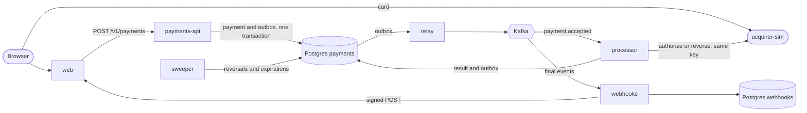
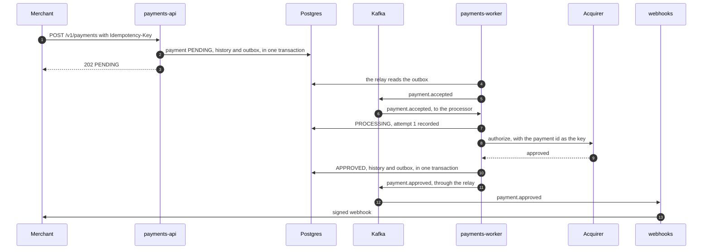

# RFC 0001: Architecture

**Status:** draft for review · **Date:** 2026-10-28 · **Owner:** Oscar Núñez · **Requirements:** [PRD](../prd.md)

## 1. Summary

This RFC describes how the service in the PRD is built, and the plan to build it.

In one paragraph: Postgres is the source of truth and enforces every guarantee, and Kafka carries the work and the facts. The API writes the payment and its event in one transaction and answers. A relay publishes the event to Kafka, workers authorize the payment with the acquirer, and the webhooks service tells the merchant. Every call to the acquirer is recorded before it is sent and always carries the same key, so a crash or a redelivery can repeat it safely. When the outcome stays unknown, the service reverses the authorization instead of guessing.

## 2. Principles

1. **Postgres decides, Kafka carries.** Every guarantee is a constraint or a conditional update in Postgres. Kafka delivers work and facts after they are committed, at least once.
2. **Write before acting.** Every attempt is recorded before its call, and every reversal before it is sent.
3. **One key per payment.** Every call to the acquirer for a payment carries the payment id as its idempotency key, so repeating a call is always safe. With an idempotent acquirer, repeating the authorization is also the way to ask what happened.
4. **When in doubt, reverse.** A payment never ends `FAILED` while it may be authorized at the acquirer.
5. **Work that must wait lives in Postgres.** Kafka carries what should happen now. Retries of reversals and webhooks, and expirations, are rows with a due time.
6. **Every consumer tolerates duplicates.** Processing a message twice changes nothing.
7. **Every guarantee has a test, and nothing is claimed before it is proven.**

## 3. Components

| Component | Responsibility | State |
|---|---|---|
| `payments-api` | Public API: merchant authentication, accepting payments, idempotency, orders and queries. | Postgres `payments` |
| `payments-worker` | The outbox relay, the processor, which authorizes payments from Kafka, and the sweeper, which retries reversals and expires payments. Same codebase and database as the API. | Postgres `payments` |
| `webhooks` | Turns final payment events into deliveries, and sends them to the merchants with retries. | Postgres `webhooks` |
| `acquirer-sim` | Simulated acquirer: tokenization, authorization by key, reversal, test cards, fault controls and its own book. | memory |
| `web` | Next.js app that plays the merchant: a test checkout and a panel. | memory |
| `migrate`, `seed` | One-shot commands: the migrations and the local seed data. | none |

Infrastructure: one Postgres server, with one database and one role per service; Kafka in KRaft mode, with one broker locally; and Jaeger for traces.

## 4. Architecture



The relay, the processor and the sweeper run inside `payments-worker`. The API talks only to Postgres, so neither Kafka nor the acquirer can slow it down.

A payment, on the normal path:



## 5. Processing a payment

### 5.1 Accepting

1. `payments-api` authenticates the API key, checks that the merchant is active, and validates the input and the amount limits. A failure answers `400`, `401` or `422` and creates nothing.
2. In one transaction, it inserts the payment as `PENDING` with `INSERT … ON CONFLICT (merchant_id, idempotency_key) DO NOTHING`, together with its first history row and the outbox row for `payment.accepted`.
   - If the key already exists, the request is a retry (section 6).
   - If the order already has a live payment, the unique index on orders rejects the insert, and the answer is `409 order_has_active_payment`.
3. It answers `202` with the payment and its `Location`.

### 5.2 Processing

The processor is a consumer group on `payments.events.v1`, and it acts on `payment.accepted`. Each worker instance processes up to 256 payments at a time from its partitions. For each payment:

1. **Claim.** A conditional update moves the payment to `PROCESSING` and increments its epoch, only if the payment is not final and no reversal has started.
   - If it is final, the message is a duplicate and is skipped.
   - If its reversal has started, the sweeper owns it, and the message is skipped too.
   - If it has no attempt yet and is older than 2 minutes, it ends `FAILED` with reason `expired` (section 5.4).
2. **Attempt.** It records the attempt in the history, conditional on the epoch, before the call. Then it calls the acquirer with the payment id as the idempotency key and a 5 s timeout.
3. **Result.** One transaction records the final state, its history row and the outbox row of the final event, with an update conditional on the epoch:
   - `APPROVED`, with the authorization code and the card summary;
   - `DECLINED`, with the decline code;
   - or `FAILED` with reason `acquirer_rejected`.

   If the update finds a different epoch, another worker owns the payment, and this one stops.
4. **Commit.** The offset is committed only once the payment is final or handed to the sweeper. Within a partition, payments finish in any order, so the committed offset is the highest one below which every payment is finished. A crash redelivers from there, and the payments that are already final are skipped at the claim.

If a database write fails, the worker retries it. If the worker dies, the redelivered message repeats the call with the same key, and the acquirer returns the answer it already gave.

### 5.3 Retries, uncertainty and reversal

Each answer from the acquirer falls into one class:

| Answer | Class | What follows |
|---|---|---|
| Approved or declined | Definite | The final state |
| `4xx` other than `408` and `429` | Rejected | `FAILED`, reason `acquirer_rejected` |
| Connection refused | Not sent | Another attempt |
| Timeout, connection reset after sending, `5xx`, `408`, `429`, or an unreadable or incomplete answer | Uncertain | Another attempt |

- A payment gets up to 3 attempts without a definite answer. The wait between attempts doubles from a 2 s base, with half of it random: 1–2 s, then 2–4 s.
- Repeating an uncertain attempt is safe, and it is also the inquiry: the acquirer returns the answer it stored for the key, or processes the request for the first time.
- When the attempts run out:
  - if every attempt was refused before it was sent, the payment ends `FAILED` with reason `acquirer_unavailable`, since nothing reached the acquirer;
  - otherwise, a transaction records that the reversal started, conditional on the epoch, and only then does the worker send the reversal. Once the acquirer confirms it, the payment ends `FAILED` with reason `acquirer_unavailable`. If the reversal fails, the message is committed and the sweeper retries the reversal (section 5.5).
- The acquirer keeps a tombstone for every reversed key and rejects any later authorization with it. A request delayed in the network therefore cannot authorize the payment after its reversal (section 10).

### 5.4 Circuit breaker and expiry

- **Circuit breaker.** Each worker instance has one.
  - After 5 consecutive answers that are uncertain or not sent, from any payments, it opens for 30 s.
  - While it is open, the worker stops fetching from Kafka, and the payments in progress wait for their next attempt without spending it.
  - After the cool-down, a single call probes the acquirer: a definite answer closes the breaker, and a failure opens it again.
  - Any definite answer resets the count.
- **Expiry.** A payment with no attempt that is older than 2 minutes ends `FAILED` with reason `expired`.
  - The processor checks it at the claim, and the sweeper applies it to the payments still in `PENDING`, so they reach a final state even while Kafka is down.
  - Nothing was sent, so nothing is left open at the acquirer.
  - The epoch makes an expiry and an attempt mutually exclusive: whichever writes first wins, and the other's conditional update fails.

### 5.5 Sweeper

Every 5 s, each `payments-worker` claims rows with `FOR UPDATE SKIP LOCKED`. A claim increments the epoch, as the processor's does, and moves the next attempt forward, which works as a lease; the call to the acquirer happens after the claim's transaction commits. The sweeper:

- retries the reversals that are due, with waits that double from 5 s up to 1 minute, until the acquirer confirms them; a reversal never gives up;
- expires the `PENDING` payments older than 2 minutes;
- raises an alert for any payment in `PROCESSING` for more than 5 minutes (INV04).

### 5.6 Time budget

| Limit | Initial value |
|---|---|
| Acquirer call timeout | 5 s |
| Attempts without a definite answer | 3 |
| Wait between attempts | 1–2 s, then 2–4 s |
| Circuit breaker | opens after 5 failures, for 30 s |
| Expiry of payments never sent | 2 minutes |
| Sweeper interval | 5 s |
| Reversal retries | from 5 s, doubling up to 1 minute |
| Alert for an unresolved payment | 5 minutes |
| Kafka rebalance timeout | 60 s |
| Graceful shutdown | 20 s for `payments-api`, 30 s for `payments-worker` |
| Postgres statement and idle-in-transaction timeouts | 2 s and 5 s |

Without the breaker, the worst case for one payment is 3 × 5 s of attempts plus up to 6 s of waits: about 21 s. That is below both the rebalance timeout and the worker's shutdown grace, so a worker that loses a partition, or stops, can finish what it has in flight. No transaction stays open during a call, so a slow acquirer never holds locks.

### 5.7 When something fails

| Failure | What happens |
|---|---|
| The API dies after the commit, before answering | The merchant retries with the same key and gets the payment. |
| Kafka is down | Payments are accepted and the outbox grows. They are processed when Kafka is back, or they expire. |
| The relay dies after publishing, before deleting | The batch is published twice. The processor skips the payments already final, and the webhooks service discards events it already has. |
| A worker dies before recording the attempt | Nothing was sent. The redelivered message starts the attempt. |
| A worker dies after sending | The redelivered message repeats the call with the same key and gets the acquirer's answer. |
| The acquirer approves and recording it fails | The worker retries the write. If it dies, the redelivery asks again with the same key. |
| Two workers hold one payment during a rebalance | Both may call with the same key, which the acquirer deduplicates. Only the latest epoch can write. |
| The acquirer is slow or down | Retries, then the circuit breaker. Payments wait, and the API is not affected. |
| The acquirer never answers | Reversal, then `FAILED`. |
| Postgres is down | The API answers `503` and the workers retry. Nothing is committed, so nothing is lost. |

## 6. Idempotency and orders

The idempotency key lives in the payment row, with no table of its own. It is unique per merchant, and the row also keeps a request hash: a SHA-256 of the canonical request (order id, amount, currency and card token).

| Request | Response |
|---|---|
| New key | Processed normally |
| Same key, same hash | `202` with the payment in its current state and `Idempotent-Replayed: true` |
| Same key, different hash | `422 idempotency_key_reused` |
| Same key, at the same time | The second insert waits on the unique index until the first commits, then follows the rows above |

- The insert comes first and the key is looked up only on a conflict, so a new payment costs one round trip.
- A request rejected by a business rule also looks up its key before answering `422`: a retry of a payment that was already accepted gets its payment, even if a limit changed since. If that lookup fails, the answer is `500`, not `422`, because the payment might exist.
- Requests rejected with `400` or `422` do not use up their key.

An order has at most one payment that is pending, processing or approved. A partial unique index enforces it (section 7), so two concurrent payments for one order cannot both be inserted.

## 7. Data model

The `payments` database:

| Table | Purpose |
|---|---|
| `merchants` | Legal name, RUT, status and the maximum amount per currency |
| `api_keys` | The merchant, a prefix and a SHA-256 hash of the secret, and the dates it was created and revoked |
| `payments` | Id (UUID), merchant, order id, idempotency key, request hash, amount, currency, card token, card brand and last 4, status, reason, authorization code, decline code, attempts, epoch, reversal start and next reversal time, and timestamps |
| `payment_events` | One row per status change and per call to the acquirer: type, statuses, attempt, outcome, latency and response code |
| `outbox` | Events waiting for the relay |

The `webhooks` database:

| Table | Purpose |
|---|---|
| `endpoints` | Each merchant's URL and signing secret |
| `deliveries` | Event id (unique), merchant, payload, status, attempts, next attempt and the last response |

The constraints that carry the guarantees:

```sql
-- INV01: one key, one payment.
CREATE UNIQUE INDEX payments_one_per_key
    ON payments (merchant_id, idempotency_key);

-- INV02: an order has at most one live or approved payment.
CREATE UNIQUE INDEX payments_one_live_per_order
    ON payments (merchant_id, order_id)
    WHERE status IN ('PENDING', 'PROCESSING', 'APPROVED');

-- A failed payment always says why, and only a failed one has a reason.
ALTER TABLE payments ADD CONSTRAINT payments_reason_when_failed
    CHECK ((status = 'FAILED') = (reason IS NOT NULL));
```

Other indexes serve the list, newest first per merchant, and the sweeper's scans over `PENDING` and `PROCESSING` payments.

## 8. Kafka

### 8.1 Topics and events

| Topic | Key | Partitions | Retention | Producer | Consumers |
|---|---|---|---|---|---|
| `payments.events.v1` | payment id | 24 | 7 days | `payments-worker`, through the relay | the processor (`payment.accepted`) and `webhooks` (final events) |
| `payments.dlq.v1` | as received | 1 | 30 days | any consumer | none: inspected by hand |

- The event types are `payment.accepted`, `payment.approved`, `payment.declined` and `payment.failed`.
- Each event is JSON with an envelope: event id (a UUID, which is also the webhook's event id), type, payment id, merchant id, occurrence time, and the payment as the API shows it. The trace context travels in the Kafka headers.
- The contracts are Go types in `internal/events`, shared by the producer and the consumers. A golden-file test fails on an incompatible change.
- The partition count caps the number of worker instances at 24.
- Topics are created by a one-shot step in Compose, never automatically.

### 8.2 Outbox and relay

Every change that produces an event writes it to the `outbox` table in the same transaction. The relay runs inside `payments-worker` and:

1. holds a Postgres advisory lock, so only one instance publishes; the others wait to take over;
2. reads up to 500 rows, ordered by id;
3. produces them with franz-go, as an idempotent producer with `acks=all`;
4. deletes the rows once Kafka acknowledges them, and repeats. When there is nothing to publish, it polls every 20 ms.

The events of one payment are written in separate transactions, one after the other, so they are published in order. A crash between producing and deleting publishes a batch twice, which the consumers tolerate.

### 8.3 Consumers

- Delivery is at least once, and offsets are committed after the database commit.
- The processor detects duplicates by the payment's state (section 5.2), and the webhooks service by the event id.
- Within a partition, several messages are in flight at once, and the committed offset only covers the ones finished in sequence (section 5.2).
- When a worker loses a partition in a rebalance, it stops fetching from it, waits for its payments in flight up to the rebalance timeout, and commits. A payment still in flight after that is fenced by its epoch.
- A message that cannot be decoded goes to `payments.dlq.v1` and is committed. Any other error is retried in place, with backoff.

## 9. Webhooks

- The consumer inserts one delivery per final event, with `ON CONFLICT (event_id) DO NOTHING`, and then commits.
- A dispatcher claims due deliveries with `FOR UPDATE SKIP LOCKED` and a lease, and posts each event to the merchant's endpoint with a 5 s timeout.
- **Signature:** the header `Webhook-Signature: t=<unix seconds>,v1=<hex HMAC-SHA256 of "t.body" with the endpoint's secret>`. The receiver checks the signature and rejects timestamps older than 5 minutes.
- A `2xx` marks the delivery as delivered. Anything else waits 10 s, doubling with jitter up to 1 hour, for 24 hours; after that, the delivery is marked failed.
- A delivery goes out at least once, and the event id lets the merchant discard duplicates.

## 10. Acquirer simulator

| Endpoint | Caller | Behavior |
|---|---|---|
| `POST /v1/tokens` | The browser, with a publishable key | Card number, expiry and CVC in; token, brand and last 4 out. Rejects numbers that fail the Luhn check and expired cards. A token lasts 1 hour. |
| `POST /v1/authorizations` | `payments-worker`, with a secret key and an `Idempotency-Key` | Token, amount, currency and merchant reference in. Answers approved with an authorization code, or declined with a code, plus the card summary. The same key gets the same answer, and a reversed key answers `409 reversed`. |
| `POST /v1/authorizations/{key}/reversal` | `payments-worker` | Releases the authorization if there is one, and leaves a tombstone so the key can never be authorized. It is idempotent and also works for a key it never saw. |
| `GET /admin/book` | Tests and the consistency checker | Every key and its state. |
| `PUT /admin/faults` | The panel and the load tests | Latency, error rate, timeout rate, or down. |

Test cards:

| Card | Behavior |
|---|---|
| `4111111111111111` | Approved |
| `4000000000000002` | Declined, `card_declined` |
| `4000000000009995` | Declined, `insufficient_funds` |
| `4000000000000119` | `503` on every authorization: the payment is reversed and ends `FAILED`, `acquirer_unavailable` |
| `4000000000000127` | `503` on the first authorization, then approved |
| `4000000000000135` | Approves, but answers after the timeout |
| `4000000000000143` | `422`: `FAILED`, `acquirer_rejected` |
| `4000000000000150` | Approves and never answers |

The simulator keeps its book in memory. Restarting it is like moving to a new acquirer, so the tests never do it.

## 11. Public API

- **Base URL:** `payments-api` serves `/v1`.
- **Authentication:** `Authorization: Bearer sk_test_…`.
- **Errors:** `{"error": {"code": "...", "message": "...", "param": "..."}}`, with stable codes such as `order_has_active_payment` or `idempotency_key_reused`.
- **Status codes:** `202` for an accepted payment and for its replays; `200` for queries; `400`, `401`, `404`, `409` and `422`; `500`; and `503` while Postgres is unavailable.
- **Pagination:** `limit` (50 by default, 100 at most) and `starting_after`, a payment id, with `has_more` in the answer.
- **Specification:** OpenAPI 3.1 in `api/`.

Example:

```http
POST /v1/payments
Authorization: Bearer sk_test_…
Idempotency-Key: order-1001-attempt-1
Content-Type: application/json

{
  "order_id": "1001",
  "amount": 15000,
  "currency": "CLP",
  "card_token": "tok_3fM1…"
}
```

```http
HTTP/1.1 202 Accepted
Location: /v1/payments/5b0c…

{
  "id": "5b0c…",
  "order_id": "1001",
  "status": "PENDING",
  "amount": 15000,
  "currency": "CLP",
  "created_at": "2026-10-28T19:02:11.314Z"
}
```

## 12. Checkout and panel

- A Next.js app. Its server calls the API with the demo merchant's secret key, so the browser never holds it. The browser talks only to the acquirer, to tokenize the card.
- Pages: the checkout, the payment list, the detail of a payment with its history (which refreshes while the payment is in flight), the webhooks received, and the acquirer controls.
- The webhooks arrive at a route of the app, which checks their signature and keeps the latest ones in memory.

## 13. Observability

- **Traces:** OpenTelemetry. The trace context goes from the request to the outbox row, from the row to the Kafka headers, and from there to each consumer, so a payment is a single trace from the `POST` to the webhook (NFR07). The services send their spans to Jaeger over OTLP.
- **Logs:** JSON with the trace id, the payment id and the merchant id. Card tokens and API keys are never logged.
- **Metrics:** not in this iteration. k6 measures latency and throughput, and the roadmap adds Prometheus.

## 14. Security

- No card data reaches the service, only tokens (NFR06).
- API keys are 32 random bytes, shown once and stored as a SHA-256 hash. A slow hash such as bcrypt is for low-entropy passwords; a random key does not need one.
- Webhooks are signed (section 9).
- Each service connects to Postgres with its own role, which can only reach its own database.
- Compose carries development credentials only, marked as such. No real secret lives in the repository.

## 15. Testing

| Level | What it covers | Tools |
|---|---|---|
| Unit | The domain: state machine, classification of answers, backoff, RUT | `go test` |
| Integration | Postgres adapters, the relay and the consumers, against real Postgres and Kafka | testcontainers-go |
| End-to-end | The PRD scenarios against the full local environment, with the simulator's faults | `go test` against Compose |
| Consistency | The invariants after a load test with faults | a checker that compares the database, the simulator's book and the webhooks received |
| Load | NFR01 and NFR02 | k6 |

How each invariant is guaranteed and tested:

| Invariant | Mechanism | Test |
|---|---|---|
| INV01 | Unique index on the key | 20 concurrent requests with one key |
| INV02 | Partial unique index on orders | Concurrent payments for one order |
| INV03 | The same key on every call, reversal before `FAILED`, tombstones at the acquirer, epochs | Late approval, no answer, a worker killed mid-call, the consistency checker |
| INV04 | Outbox, redelivery, sweeper and an alert | Kafka down; workers killed under load |
| INV05 | The final state is committed with its event, and events come only from the outbox | The consistency checker |
| INV06 | Outbox, one delivery per event id, retries | The endpoint-down scenario; duplicate publishing |

## 16. Repository layout

One Go module, with one `main` per deployable:

```
cmd/            payments-api, payments-worker, webhooks, acquirer-sim,
                migrate, seed, healthcheck
internal/
  payments/     domain, use cases and adapters (ADR 0004)
  webhooks/
  acquirersim/
  events/       event contracts
  platform/     config, logging, telemetry, HTTP, Postgres, the outbox and Kafka
api/            OpenAPI
migrations/     one folder per database
web/            checkout and panel (Next.js)
tests/          end-to-end, the consistency checker and k6
deploy/local/   configuration for Compose
docs/           PRD, RFC, roadmap and decisions (ADR)
compose.yaml
```

Each significant decision gets an ADR in `docs/decisions/`, written in the pull request that implements it.

## 17. Plan

One pull request per step. Each one leaves `main` working and passes its review before merge.

| # | Pull request | Delivers | Done when |
|---|---|---|---|
| 1 | Scope | This RFC, the PRD and the roadmap; Valkey and the collector removed | CI is green and `docker compose up` is healthy |
| 2 | Acquirer simulator | Tokens, authorizations by key, reversal with tombstones, test cards, faults and the book | The contract tests pass |
| 3 | Merchants | Merchants, API keys, authentication, RUT validation and the seed command | The authentication and isolation tests pass |
| 4 | Accepting and querying payments | `POST` with idempotency and orders, `GET`, the list, the history and the outbox rows | The idempotency and order scenarios pass |
| 5 | Relay and processing | Topics, the relay, the processor with concurrent partitions and ordered commits, attempts, retries and final states | A payment goes from `POST` to `APPROVED` through Kafka, and the retry scenarios pass |
| 6 | Uncertainty and failures | Reversal, the sweeper, expiry, the circuit breaker and epochs | The failure scenarios pass, including a worker killed mid-call and Kafka down |
| 7 | Webhooks | The consumer, deliveries, signatures and retries | The endpoint-down scenario passes |
| 8 | Checkout and panel | The web app | A test payment can be made and followed from the browser |
| 9 | Proof | The end-to-end suite in CI, the consistency checker under faults, the k6 results and the final README | Every scenario passes, and the results are in the README |

## 18. Alternatives considered

| Alternative | Why not |
|---|---|
| Postgres as the queue (`SKIP LOCKED` with polling) | It works and it is simpler. Kafka adds scaling by partitions, new work without polling, and one stream of facts that other consumers read without touching the payments database: webhooks now, a ledger later. |
| Publishing to Kafka from the API (dual write) | A crash between the commit and the publish loses the event, or publishes one for a change that rolled back. |
| Change data capture with Debezium | During a long Kafka outage, the replication slot keeps WAL until the database disk fills, and a Kafka outage becomes a payments outage. |
| Authorizing inside the request | The checkout would get the result in the same response, but the API would hold a connection per payment for as long as the acquirer takes, and a slow acquirer would slow the API down. A short wait for the result is in the roadmap. |
| Retry topics for the waits between attempts | They free the slot during the wait, at the cost of more topics and ordering rules. The waits here last seconds, so a slot is cheap. |
| One message at a time per partition | Simpler commits, but the partition count would cap concurrency: with an acquirer at 300 ms, 24 partitions process about 80 payments per second. |
| A workflow engine such as Temporal | It would solve retries and timers, but it would hide the protocol this project exists to show. |

## 19. Open questions

- Should the `POST` wait a few seconds for the result (`Prefer: wait=N`, RFC 7240)? Proposal: not in this iteration (PRD, section 16).
