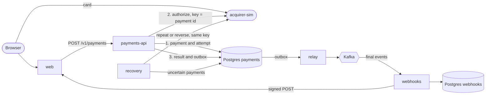
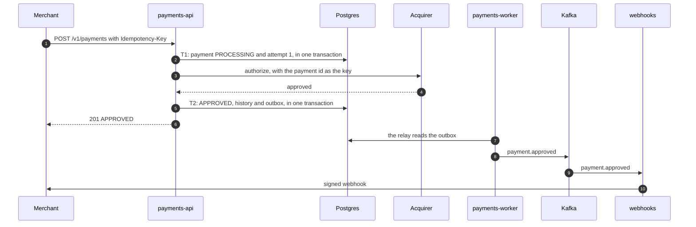

# RFC 0001: Architecture

**Status:** draft for review · **Date:** 2026-10-28 · **Updated:** 2026-10-29, authorization moved into the request ([ADR 0005](../decisions/0005-authorize-in-the-request-recover-in-the-background.md)) · **Owner:** Oscar Núñez · **Requirements:** [PRD](../prd.md)

## 1. Summary

This RFC describes how the service in the PRD is built, and the plan to build it.

In one paragraph: the API authorizes a payment inside the merchant's request and answers with the result, the way card APIs usually work. Before calling the acquirer, it records the payment and the attempt, so a crash never leaves an unknown that cannot be resolved. When the acquirer does not give a clear answer, the API says the payment is processing, and a recovery worker finishes it in the background: it repeats the call with the same key, and reverses the authorization when the outcome stays unknown. Postgres enforces every guarantee. Kafka carries the facts that already happened to the services downstream, starting with webhooks, and it is not on the path of a payment.

## 2. Principles

1. **Postgres decides, Kafka carries.** Every guarantee is a constraint or a conditional update in Postgres. Kafka delivers facts after they are committed, at least once.
2. **Answer in the request when possible, finish in the background when not.** The merchant gets the result in the response whenever the acquirer gives one in time.
3. **The payment path depends on as little as possible:** Postgres and the acquirer. Never on Kafka or a downstream service.
4. **Write before acting.** Every attempt is recorded before its call, and every reversal before it is sent.
5. **One key per payment.** Every call to the acquirer for a payment carries the payment id as its idempotency key, so repeating a call is always safe. With an idempotent acquirer, repeating the authorization is also the way to ask what happened.
6. **When in doubt, reverse.** A payment never ends `FAILED` while it may be authorized at the acquirer.
7. **Every consumer tolerates duplicates.** Processing a message twice changes nothing.
8. **Every guarantee has a test, and nothing is claimed before it is proven.**

## 3. Components

| Component | Responsibility | State |
|---|---|---|
| `payments-api` | Public API: merchant authentication, idempotency, orders, the authorization of each payment inside its request, and queries. | Postgres `payments` |
| `payments-worker` | The outbox relay, and the recovery of the payments whose outcome is still unknown: retries and reversals. Same codebase and database as the API. | Postgres `payments` |
| `webhooks` | Turns final payment events into deliveries, and sends them to the merchants with retries. | Postgres `webhooks` |
| `acquirer-sim` | Simulated acquirer: tokenization, authorization by key, reversal, test cards, fault controls and its own book. | memory |
| `web` | Next.js app that plays the merchant: a test checkout and a panel. | memory |
| `migrate`, `seed` | One-shot commands: the migrations and the local seed data. | none |

Infrastructure: one Postgres server, with one database and one role per service; Kafka in KRaft mode, with one broker locally; and Jaeger for traces.

## 4. Architecture



Everything left of the relay happens inside the merchant's request, or in the recovery when the request could not finish. The relay and the recovery run inside `payments-worker`. If Kafka is down, payments are still authorized and answered; only their events wait in the outbox.

A payment, on the normal path:



## 5. Processing a payment

### 5.1 Accepting and authorizing

1. `payments-api` authenticates the API key, checks that the merchant is active, and validates the input and the amount limits. A failure answers `400`, `401` or `422` and creates nothing.
2. **T1.** In one transaction, it inserts the payment as `PROCESSING` with `INSERT … ON CONFLICT (merchant_id, idempotency_key) DO NOTHING`, with epoch 1, and with a lease: if no answer is recorded within 15 s, the recovery takes the payment over.
   - If the key already exists, the request is a retry and gets its payment (section 6). A retry never goes through the gate below, so a merchant that lost a response always gets the payment back.
   - If the order already has a live payment, the unique index on orders rejects the insert, and the answer is `409 order_has_active_payment`.
3. **The gate.** For a new payment, still inside T1, it checks the circuit breaker and the payments the instance has in flight (section 5.4). Both live in memory, so the check costs no round trip. If the breaker is open or the instance is at its limit, T1 rolls back and the answer is `503` with `Retry-After`: nothing is created, and the key stays free. Otherwise, T1 writes the first history row, records attempt 1 before the call, and commits.
4. **The call.** It calls the acquirer with the payment id as the idempotency key and a 5 s timeout. No database connection is held while waiting. The call and T2 do not depend on the merchant's connection: if the merchant hangs up, the answer is still recorded, and its retry gets it.
5. **T2.** It records the answer (section 5.2) and responds:
   - `201` with `APPROVED`, `DECLINED`, or `FAILED` with reason `acquirer_rejected`;
   - `202` with `PROCESSING` when the answer was not clear: the recovery continues, and the merchant learns the result by webhook or with `GET`.

### 5.2 Recording the answer

T2 is one transaction, with an update conditional on the payment being `PROCESSING` and on the epoch the writer holds:

- a definite answer records the final state with its authorization or decline code and the card summary, the history row of the call with its latency and response code, and the outbox row of the final event;
- an unclear answer records the outcome of the attempt, and moves the lease to the end of the wait before the next attempt (section 5.3), so the recovery picks the payment up then.

If the update finds another epoch, the recovery took the payment over, which only happens if the request outlived its lease. The API then answers with the payment as it is. If T2 itself fails, the API answers `202`: the payment exists, and the recovery will repeat the call with the same key once the lease expires.

### 5.3 Retries, uncertainty and reversal

Each answer from the acquirer falls into one class:

| Answer | Class | What follows |
|---|---|---|
| Approved or declined | Definite | The final state |
| `4xx` other than `408` and `429` | Rejected | `FAILED`, reason `acquirer_rejected` |
| Connection refused | Not sent | Another attempt |
| Timeout, connection reset after sending, `5xx`, `408`, `429`, or an unreadable or incomplete answer | Uncertain | Another attempt |

- A payment gets up to 3 attempts without a definite answer: the first in the request, and the others in the recovery. The wait before each new attempt doubles from a 2 s base, with half of it random: 1–2 s, then 2–4 s.
- Repeating an uncertain attempt is safe, and it is also the inquiry: the acquirer returns the answer it stored for the key, or processes the request for the first time.
- **The authorization window.** No new authorization is sent more than 2 minutes after the payment was created, so a customer who has left the checkout is never charged late. A payment that reaches the window without a definite answer is handled as if its attempts had run out.
- When the attempts run out:
  - if every attempt was refused before it was sent, the payment ends `FAILED` with reason `acquirer_unavailable`, since nothing reached the acquirer;
  - otherwise, a transaction records that the reversal started, conditional on the epoch, and only then is the reversal sent. Once the acquirer confirms it, the payment ends `FAILED` with reason `acquirer_unavailable`. A reversal that fails is retried by the recovery, with waits that double from 5 s up to 1 minute, and it never gives up.
- The acquirer keeps a tombstone for every reversed key and rejects any later authorization with it. A request delayed in the network therefore cannot authorize the payment after its reversal (section 10).

### 5.4 Circuit breaker and load shedding

- **Circuit breaker.** Each instance of `payments-api` and `payments-worker` has one.
  - After 5 consecutive answers that are uncertain or not sent, from any payments, it opens for 30 s.
  - While it is open, `payments-api` answers new payments with `503` and `Retry-After` without creating them, and the recovery holds its attempts. The authorization window keeps running.
  - Until it opens, an outage is discovered by the calls themselves: the few payments created before the breaker opens answer `202`, and the recovery finishes them. No call can tell that the acquirer is down before trying.
  - After the cool-down, a single call probes the acquirer: a definite answer closes the breaker, and a failure opens it again. Any definite answer resets the count.
- **Load shedding.** Each instance of `payments-api` has at most 512 payments in flight at the acquirer. Beyond that, it answers new payments with `503` and `Retry-After`, so a slow acquirer cannot pile up requests without limit. Like the breaker, the limit is checked inside T1, after the key, so retries of existing payments are always answered.

### 5.5 Recovery

In each `payments-worker`, every second, the recovery claims the `PROCESSING` payments whose lease has expired, with `FOR UPDATE SKIP LOCKED`. A claim increments the epoch and moves the lease 15 s forward; the call to the acquirer happens after the claim's transaction commits. For each payment:

- if its reversal started, it sends the reversal again;
- if it has attempts left and is inside its authorization window, it records a new attempt, repeats the authorization with the same key and records the answer as in section 5.2;
- otherwise, its attempts have run out, and it follows section 5.3.

It also raises an alert for any payment in `PROCESSING` for more than 5 minutes (INV04). The API and the recovery apply the same rules, implemented once in the use cases (ADR 0004). The recovery does not depend on Kafka, so it keeps working while Kafka is down.

### 5.6 Time budget

| Limit | Initial value |
|---|---|
| Acquirer call timeout | 5 s |
| Lease of a payment being authorized | 15 s |
| Recovery scan | every second |
| Attempts without a definite answer | 3, the first in the request |
| Wait before a new attempt | 1–2 s, then 2–4 s |
| Authorization window | 2 minutes from creation |
| Reversal retries | from 5 s, doubling up to 1 minute |
| Circuit breaker | opens after 5 failures, for 30 s |
| Payments in flight per API instance | 512 |
| Alert for an unresolved payment | 5 minutes |
| Graceful shutdown | 20 s for each service |
| Postgres statement and idle-in-transaction timeouts | 2 s and 5 s |

The chain is 5 s < 15 s < 20 s: a call always ends before its lease expires, and a shutdown waits for the calls in flight. No transaction stays open during a call, so a slow acquirer never holds locks. The worst case for the merchant is a `202` about 5 s after the request.

### 5.7 When something fails

| Failure | What happens |
|---|---|
| The API dies after T1, before or after the call | The lease expires and the recovery repeats the call with the same key. If the merchant retries meanwhile, it gets the payment as `PROCESSING`. |
| The acquirer approves and T2 fails | The API answers `202`. The recovery repeats the call with the same key and gets the same approval. |
| The acquirer answers late | The API answers `202` after its timeout. The recovery repeats the call and gets the answer the acquirer stored. |
| The acquirer never answers | Attempts, then the reversal, then `FAILED`. |
| The acquirer is down | The first calls fail and their payments answer `202`. After 5 failures the breaker opens: from then on, new payments get `503` and nothing is created, and the payments in progress wait. |
| A worker is slow and another claims the same payment | Both may call with the same key, which the acquirer deduplicates. Only the latest epoch can write. |
| Kafka is down | Payments are authorized and answered as usual. Their events wait in the outbox, and webhooks are delivered when Kafka is back. |
| The relay dies after publishing, before deleting | The batch is published twice, and the webhooks service discards the events it already has. |
| Postgres is down | The API answers `503` and creates nothing; the recovery retries. Nothing is committed, so nothing is lost. |

## 6. Idempotency and orders

The idempotency key lives in the payment row, with no table of its own. It is unique per merchant, and the row also keeps a request hash: a SHA-256 of the canonical request (order id, amount, currency and card token).

| Request | Response |
|---|---|
| New key | Processed normally |
| Same key, same hash | The payment in its current state, with `Idempotent-Replayed: true`: `201` when it is final, `202` while it is processing |
| Same key, different hash | `422 idempotency_key_reused` |
| Same key, at the same time | The second insert waits on the unique index until the first commits, then follows the rows above |

- The insert comes first and the key is looked up only on a conflict, so a new payment costs one round trip.
- A request rejected by a business rule also looks up its key before answering `422`: a retry of a payment that was already accepted gets its payment, even if a limit changed since. If that lookup fails, the answer is `503`, not `422`, because the payment might exist.
- Requests rejected with `400`, `422` or `503` do not use up their key.

An order has at most one payment that is processing or approved. A partial unique index enforces it (section 7), so two concurrent payments for one order cannot both be inserted.

## 7. Data model

The `payments` database:

| Table | Purpose |
|---|---|
| `merchants` | Legal name, RUT and status |
| `merchant_limits` | The maximum amount per payment, for each currency the merchant accepts |
| `api_keys` | The merchant, the first characters and a SHA-256 hash of the secret, and the dates it was created and revoked |
| `payments` | Id (UUIDv7, so ids sort by time), merchant, order id, idempotency key, request hash, amount, currency, card token, card brand and last 4, status, reason, authorization code, decline code, attempts, epoch, lease, reversal start, and timestamps |
| `payment_history` | One row per status change and per call to the acquirer: kind, status, attempt, outcome, latency, response code and reason |
| `outbox` | Events waiting for the relay |

The `webhooks` database:

| Table | Purpose |
|---|---|
| `endpoints` | Each merchant's URL and signing secret |
| `deliveries` | Event id (unique), merchant, payload, status, attempts, next attempt and the last response |

The constraints that carry the guarantees:

```sql
-- INV01: one key, one payment.
CREATE UNIQUE INDEX payments_one_per_key
    ON payments (merchant_id, idempotency_key);

-- INV02: an order has at most one live or approved payment.
CREATE UNIQUE INDEX payments_one_live_per_order
    ON payments (merchant_id, order_id)
    WHERE status IN ('PROCESSING', 'APPROVED');

-- A failed payment always says why, and only a failed one has a reason.
ALTER TABLE payments ADD CONSTRAINT payments_reason_when_failed
    CHECK ((status = 'FAILED') = (reason IS NOT NULL));
```

Other indexes serve the list, newest first per merchant, and the recovery's scan of the `PROCESSING` payments whose lease expired. Migration 00003 created payments with a `PENDING` status for the earlier design; the migration of step 5 removes it, and adds the columns of the recovery.

## 8. Kafka

### 8.1 Topics and events

| Topic | Key | Partitions | Retention | Producer | Consumers |
|---|---|---|---|---|---|
| `payments.events.v1` | payment id | 24 | 7 days | `payments-worker`, through the relay | `webhooks`; a ledger, later |
| `payments.dlq.v1` | as received | 1 | 30 days | any consumer | none: inspected by hand |

- The event types are `payment.approved`, `payment.declined` and `payment.failed`: one per payment, when it reaches its final state.
- Each event is JSON with an envelope: event id (a UUID, which is also the webhook's event id), type, payment id, merchant id, occurrence time, and the payment as the API shows it. The trace context travels in the Kafka headers.
- The contracts are Go types in `internal/events`, shared by the producer and the consumers. A golden-file test fails on an incompatible change.
- Topics are created by a one-shot step in Compose, never automatically.

### 8.2 Outbox and relay

Every change that produces an event writes it to the `outbox` table in the same transaction. The relay runs inside `payments-worker` and:

1. holds a Postgres advisory lock, so only one instance publishes; the others wait to take over;
2. reads up to 500 rows, ordered by id;
3. produces them with franz-go, as an idempotent producer with `acks=all`;
4. deletes the rows once Kafka acknowledges them, and repeats. When there is nothing to publish, it polls every 20 ms.

A crash between producing and deleting publishes a batch twice, which the consumers tolerate.

### 8.3 Consumers

- Delivery is at least once, and offsets are committed after the database commit.
- The webhooks service detects duplicates by the event id.
- A message that cannot be decoded goes to `payments.dlq.v1` and is committed. Any other error is retried in place, with backoff.

## 9. Webhooks

- The consumer inserts one delivery per final event, with `ON CONFLICT (event_id) DO NOTHING`, and then commits.
- A dispatcher claims due deliveries with `FOR UPDATE SKIP LOCKED` and a lease, and posts each event to the merchant's endpoint with a 5 s timeout.
- **Signature:** the header `Webhook-Signature: t=<unix seconds>,v1=<hex HMAC-SHA256 of "t.body" with the endpoint's secret>`. The receiver checks the signature and rejects timestamps older than 5 minutes.
- A `2xx` marks the delivery as delivered. Anything else waits 10 s, doubling with jitter up to 1 hour, for 24 hours; after that, the delivery is marked failed.
- A delivery goes out at least once, and the event id lets the merchant discard duplicates.

## 10. Acquirer simulator

The simulator listens on two ports. The public one serves browsers, `payments-api` and `payments-worker`. The admin one serves the book, the faults and the health probe, and keeps working while the public one is down.

| Endpoint | Caller | Behavior |
|---|---|---|
| `POST /v1/tokens` | The browser, with a publishable key | Card number, expiry and CVC in; token, brand and last 4 out. Rejects numbers that fail the Luhn check and expired cards. A token lasts 1 hour and pays for a single authorization key. |
| `POST /v1/authorizations` | `payments-api` and `payments-worker`, with a secret key and an `Idempotency-Key` | Token, amount, currency and merchant reference in. Answers approved with an authorization code, or declined with a code, plus the card summary. The decision is recorded before the answer is sent, so a client that times out finds it on its retry. The same key gets the same answer, with `Idempotent-Replayed: true`; the same key with a different request answers `422 idempotency_key_reused`; and a reversed key answers `409 reversed`. |
| `POST /v1/authorizations/{key}/reversal` | `payments-api` and `payments-worker`, with a secret key | Releases the authorization if there is one, and leaves a tombstone so the key can never be authorized. It is idempotent and also works for a key it never saw. |
| `GET /admin/book` | Tests and the consistency checker | Every key: its outcome, whether it was reversed, and whether it is still live. |
| `GET` and `PUT /admin/faults` | The panel and the load tests | Latency added to every answer, the share of calls answered `503` without being processed, the share answered late, and down, which closes the public port so new connections are refused. |

Test cards:

| Card | Behavior |
|---|---|
| `4111111111111111` | Approved |
| `4000000000000002` | Declined, `card_declined` |
| `4000000000009995` | Declined, `insufficient_funds` |
| `4000000000000119` | `503` on every authorization: the payment is reversed and ends `FAILED`, `acquirer_unavailable` |
| `4000000000000127` | `503` on the first authorization, then approved |
| `4000000000000135` | Approves, but the first answer comes 8 s later, after the 5 s timeout |
| `4000000000000143` | `422`: `FAILED`, `acquirer_rejected` |
| `4000000000000150` | Approves and never answers |

The simulator keeps its book and its tokens in memory. Restarting it is like moving to a new acquirer, so the tests never do it.

## 11. Public API

- **Base URL:** `payments-api` serves `/v1`.
- **Endpoints:** `POST /v1/payments`, `GET /v1/payments/{id}` and `GET /v1/payments`; and `GET /v1/merchant`, which returns the merchant that owns the key.
- **Authentication:** `Authorization: Bearer sk_test_…`. A missing, unknown or revoked key answers `401`. When Postgres does not answer, the answer is `503`, since the key may well be valid.
- **Errors:** `{"error": {"code": "...", "message": "..."}}`, with stable codes such as `order_has_active_payment` or `idempotency_key_reused`. An invalid request also lists every malformed field, `"fields": [{"field": "amount", "message": "..."}]`, so it can be fixed in one round trip. The body accepts only the documented fields: a typo is rejected, never ignored.
- **Status codes:**
  - `201` for a payment that reached its final state in the request, and `202` for one still processing; a replay answers the same way, by the payment's current state;
  - `200` for queries;
  - `400`, `401`, `404`, `409`, `413` and `422`;
  - `503` with `Retry-After` when the acquirer is unavailable, the instance is at its limit, or Postgres does not answer. Nothing is created, and a retry with the same key is safe.
- **Pagination:** `limit` (50 by default, 100 at most) and `starting_after`, the id of the last payment of the previous page, with `has_more` in the answer. Payments are listed newest first, by id: the ids are UUIDv7, so they sort by time, and an index serves any page as fast as the first.
- **Isolation:** every query is filtered by the merchant of the key, so another merchant's payment answers `404`, as if it did not exist.
- **Specification:** OpenAPI 3.1 in `api/`.

Example:

```http
POST /v1/payments
Authorization: Bearer sk_test_…
Idempotency-Key: order-1001-attempt-1
Content-Type: application/json

{
  "order_id": "1001",
  "amount": 15000,
  "currency": "CLP",
  "card_token": "tok_3fM1…"
}
```

```http
HTTP/1.1 201 Created
Location: /v1/payments/01a187cb…

{
  "id": "01a187cb…",
  "order_id": "1001",
  "status": "APPROVED",
  "amount": 15000,
  "currency": "CLP",
  "card": {"brand": "visa", "last4": "1111"},
  "authorization_code": "7T4N4V",
  "created_at": "2026-10-29T13:13:41.225925Z",
  "updated_at": "2026-10-29T13:13:41.528311Z"
}
```

## 12. Checkout and panel

- A Next.js app. Its server calls the API with the demo merchant's secret key, so the browser never holds it. The browser talks only to the acquirer, to tokenize the card.
- The checkout shows the result as soon as the API answers. When the answer is `202`, it shows that the payment is processing and refreshes until it is final.
- Pages: the checkout, the payment list, the detail of a payment with its history, the webhooks received, and the acquirer controls.
- The webhooks arrive at a route of the app, which checks their signature and keeps the latest ones in memory.

## 13. Observability

- **Traces:** OpenTelemetry. The trace context goes from the request to the call to the acquirer, to the outbox row, from the row to the Kafka headers, and from there to the webhook, so a payment is a single trace from the `POST` to the webhook (NFR07). The services send their spans to Jaeger over OTLP.
- **Logs:** JSON with the trace id, the payment id and the merchant id. Card tokens and API keys are never logged.
- **Metrics:** not in this iteration. k6 measures latency and throughput, and the roadmap adds Prometheus.

## 14. Security

- No card data reaches the service, only tokens (NFR06).
- API keys are 128 random bits, shown once and stored as a SHA-256 hash. A slow hash such as bcrypt is for low-entropy passwords; a random key does not need one.
- Webhooks are signed (section 9).
- Each service connects to Postgres with its own role, which can only reach its own database.
- Compose carries development credentials only, marked as such. No real secret lives in the repository.

## 15. Testing

| Level | What it covers | Tools |
|---|---|---|
| Unit | The domain: state machine, classification of answers, backoff, RUT | `go test` |
| Integration | Postgres adapters, the acquirer client, the relay and the consumers, against real Postgres, Kafka and the simulator | testcontainers-go |
| End-to-end | The PRD scenarios against the full local environment, with the simulator's faults | `go test` against Compose |
| Consistency | The invariants after a load test with faults | a checker that compares the database, the simulator's book and the webhooks received |
| Load | NFR01 and NFR02 | k6 |

How each invariant is guaranteed and tested:

| Invariant | Mechanism | Test |
|---|---|---|
| INV01 | Unique index on the key | 20 concurrent requests with one key |
| INV02 | Partial unique index on orders | Concurrent payments for one order |
| INV03 | The same key on every call, the attempt recorded before the call, reversal before `FAILED`, tombstones, epochs | Late approval, no answer, the API killed mid-call, the consistency checker |
| INV04 | Leases, the recovery and an alert | The API and the worker killed under load |
| INV05 | The final state is committed with its event before the response, and events come only from the outbox | The consistency checker |
| INV06 | Outbox, one delivery per event id, retries | The endpoint-down scenario; duplicate publishing |

## 16. Repository layout

One Go module, with one `main` per deployable:

```
cmd/            payments-api, payments-worker, webhooks, acquirer-sim,
                migrate, seed, healthcheck
internal/
  payments/     domain, use cases and adapters (ADR 0004)
  webhooks/
  acquirersim/
  events/       event contracts
  platform/     config, logging, telemetry, HTTP, Postgres, the outbox and Kafka
api/            OpenAPI
migrations/     one folder per database
web/            checkout and panel (Next.js)
tests/          end-to-end, the consistency checker and k6
deploy/local/   configuration for Compose
docs/           PRD, RFC, roadmap and decisions (ADR)
compose.yaml
```

Each significant decision gets an ADR in `docs/decisions/`, written in the pull request that implements it.

## 17. Plan

One pull request per step. Each one leaves `main` working and passes its review before merge.

| # | Pull request | Delivers | Done when |
|---|---|---|---|
| 1 | Scope | This RFC, the PRD and the roadmap; Valkey and the collector removed | CI is green and `docker compose up` is healthy |
| 2 | Acquirer simulator | Tokens, authorizations by key, reversal with tombstones, test cards, faults and the book | The contract tests pass |
| 3 | Merchants | Merchants, API keys, authentication, RUT validation and the seed command | The authentication tests pass |
| 4 | Accepting and querying payments | `POST` with idempotency and orders, `GET`, the list, the history and the outbox rows | The idempotency, order and isolation scenarios pass |
| 5 | Authorization in the request | The acquirer client with its breaker, load shedding, T1 and T2, the migration to this design, the relay and the topics | A payment answers `201 APPROVED` or `201 DECLINED` in the request, its event reaches Kafka, and an unclear answer leaves it `PROCESSING` with `202` |
| 6 | Recovery | The recovery worker: leases, epochs, retries, the authorization window, reversal and the alert | The failure scenarios pass, including the API killed mid-call, the database failing after an approval, and Kafka down |
| 7 | Webhooks | The consumer, deliveries, signatures and retries | The endpoint-down scenario passes |
| 8 | Checkout and panel | The web app | A test payment can be made and followed from the browser |
| 9 | Proof | The end-to-end suite in CI, the consistency checker under faults, the k6 results and the final README | Every scenario passes, and the results are in the README |

Between steps 5 and 6, a payment with an unclear answer stays `PROCESSING` until the recovery arrives: the service never fails one blindly in the meantime.

## 18. Alternatives considered

| Alternative | Why not |
|---|---|
| Authorizing in the background through Kafka, and always answering `202` (the first design of this RFC) | It keeps the API independent of the acquirer's latency, but the merchant never gets the result in the response, and payments stop when Kafka is down. Replaced by ADR 0005. |
| The same, with a short wait for the result in the `POST` | The merchant would often get the result, but Kafka would stay on the payment path, with more moving parts between the request and its answer. |
| Authorizing in the request without a recovery | The simplest, but a request cut at the wrong moment leaves a payment stuck, or failed while the card was charged. |
| Postgres as a work queue for every payment (`SKIP LOCKED` with polling, as in v1) | It works, but with the authorization in the request there is no queue of new payments. Only the few uncertain payments wait, and the recovery claims those from Postgres in the same way. |
| Publishing to Kafka from the API (dual write) | A crash between the commit and the publish loses the event, or publishes one for a change that rolled back. |
| Change data capture with Debezium | During a long Kafka outage, the replication slot keeps WAL until the database disk fills, and a Kafka outage becomes a payments outage. |
| A workflow engine such as Temporal | It would solve retries and timers, but it would hide the protocol this project exists to show. |

## 19. Open questions

- Should the request repeat a refused connection once before answering `202`? Proposal: no. The recovery repeats it within 1–2 s, and the request stays bounded by one call.
